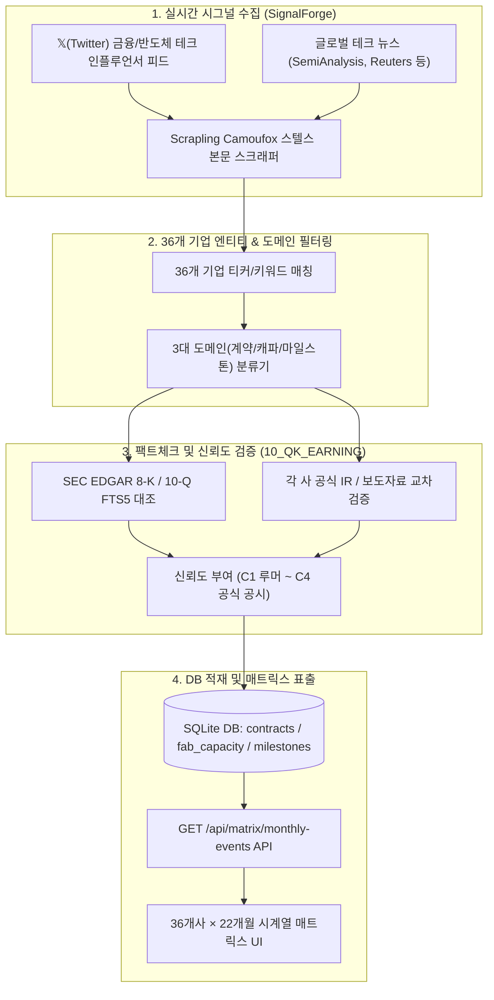

# [요건정의서] 36개 기업 월별 공급계약·생산능력·전략이정표 통합 매트릭스 체계

**문서 버전**: v1.0.0  
**작성 일자**: 2026-10-10  
**적용 프로젝트**: `10_QK_EARNING` (SiliconPulse Terminal)  
**참조 규격**:
- [2026-10-10_contracts_fab_milestones_ingestion_requirements.md](file:///Users/boon/Dropbox/03_code/b_0917_10_QK_EARNING/docs/2026-10-10_contracts_fab_milestones_ingestion_requirements.md)
- [2026-10-10_contracts_capacity_milestones_acquisition_requirements.md](file:///Users/boon/Dropbox/03_code/b_0917_10_QK_EARNING/docs/2026-10-10_contracts_capacity_milestones_acquisition_requirements.md)
- `c_1006_subject_outline` (SignalForge: 𝕏 소셜 시그널 & 실시간 테크 뉴스 자동 감시 엔진)
- `b_0910_memory_claude` (8대 레이어 36개 기업 마스터 및 DB 구조)

**분석 대상 기간**: **2025년 1월 ~ 2026년 10월 10일 (총 22개월 시계열)**  
**분석 대상 도메인**: 
1. **공급·투자 계약 (`contracts`)**
2. **생산능력 (`capacity`: Fab / Packaging / Datacenter / Power)**
3. **전략적 이정표 (`milestones`)**

---

## 1. 추진 배경 및 요건 목적

### 1.1 배경 및 문제의식
현재 터미널 시스템은 재무제표(10-Q/K), 주가 및 밸류체인 관계망을 정량적으로 시각화하고 있으나, 시장의 주가를 결정짓는 가장 직접적인 원천인 **"비정형 이벤트의 월별 전개 흐름"**을 한눈에 조망하기 어렵습니다.
- **수요(하이퍼스케일러 계약/투자)** $\to$ **공급 인프라(Fab 증설/장비 반입/CoWoS 캐파)** $\to$ **제품 상용화(테이프아웃/양산/인증)**의 연결고리가 분절되어 있음.
- 2025년 1월부터 2026년 10월 10일까지 약 22개월간 전개된 AI 반도체 슈퍼사이클의 결정적 사건들이 기업별·월별로 어떻게 상호작용했는지를 직관적인 **2차원 매트릭스(행: 월별, 열: 기업 중요도순)**로 추적하는 인텔리전스 뷰어가 요구됩니다.

### 1.2 시스템 목표
1. **36개 핵심 기업의 가중치 기반 중요도 순위(Rank 1 ~ Rank 36) 체계 확립**:
   - 가로 컬럼에 무작위 배치가 아닌, 시장 영향력·병목 독점도·CapEx 규모를 반영한 중요 순위순으로 기업을 정렬.
2. **22개월 시계열 매트릭스 구조(X: 36개사, Y: 2025-01~2026-10) 구축**:
   - 한 화면에서 월별로 각 기업의 3대 도메인(계약/캐파/이정표) 변곡점을 시각적 뱃지와 함께 스캔.
3. **`c_1006_subject_outline`(SignalForge) 엔진과의 실시간 시그널 연동**:
   - 222개 마스터 인플루언서 트윗 및 글로벌 테크 뉴스에서 실시간 추출되는 계약/캐파/이정표 후보군을 자동 감지하고, SEC 8-K 및 공식 IR로 역검증하여 매트릭스에 실시간 반영.

---

## 2. 36개 기업 중요도 평가 기준 및 전수 순위 (Rank 1 ~ 36)

### 2.1 중요도 평가 가중치 모델 (Scoring Model)
기업의 중요도는 단순 시가총액이 아닌, **"AI 반도체 밸류체인 내 공급 병목 장악력 및 자본 지출 영향력"**을 기준으로 100점 만점으로 산출합니다.

$$\text{Score} = (\text{Bottleneck} \times 0.35) + (\text{CapEx/Deal Size} \times 0.25) + (\text{Market Cap} \times 0.20) + (\text{Ripple Effect} \times 0.20)$$

1. **병목 독점도 및 대체불가성 (35%)**: HBM, 선단 파운드리(N3/N2), CoWoS, 가속기 시장 점유율 및 대체재 존재 여부.
2. **CapEx 및 계약 규모 (25%)**: 연간 설비투자 규모($B) 및 대규모 공급계약의 구매/판매 주체로서의 자금력.
3. **시가총액 및 자본시장 지배력 (20%)**: 글로벌 증시 내 비중 및 펀더멘털 규모.
4. **전후방 밸류체인 파급력 (20%)**: 해당 기업의 일정 지연 또는 계약 변경이 생태계 전반에 미치는 충격파 크기.

---

### 2.2 36개 기업 중요 순위 마스터 (확정 랭킹)

| 순위 (Rank) | Entity ID | 티커 (Ticker) | 기업명 (한글/영문) | 레이어 (Layer) | 국가 | 중요도 점수 | 핵심 역할 및 병목 지정 이유 |
| :---: | :--- | :--- | :--- | :--- | :---: | :---: | :--- |
| **1** | `NVIDIA` | NVDA | 엔비디아 (NVIDIA) | L3_COMPUTE | 🇺🇸 | **99.5** | AI 가속기 시장 85%+ 장악, 생태계 전체 현금흐름 창출원 |
| **2** | `TSMC` | TSM | TSMC | L4_FOUNDRY | 🇹🇼 | **98.8** | 선단 공정(N3/N2) 및 CoWoS 어드밴스드 패키징 독점 병목 |
| **3** | `SK_HYNIX` | 000660.KS | SK하이닉스 (SK hynix) | L5_MEMORY | 🇰🇷 | **96.5** | HBM3E/HBM4 시장 1위, 엔비디아 가속기 공급망 핵심 키 |
| **4** | `MICROSOFT` | MSFT | 마이크로소프트 (Microsoft) | L2_HYPERSCALER | 🇺🇸 | **95.2** | 연간 $60B+ AI CapEx 집행 주체, OpenAI 최대 후원사 |
| **5** | `SAMSUNG` | 005930.KS | 삼성전자 (Samsung Electronics) | L5_MEMORY | 🇰🇷 | **94.0** | 메모리(DRAM/NAND/HBM) 최대 캐파, 턴키 파운드리 잠재력 |
| **6** | `GOOGLE` | GOOGL | 알파벳/구글 (Alphabet) | L2_HYPERSCALER | 🇺🇸 | **93.5** | 자체 TPU v5/v6 생태계 구축, 거대 AI 인프라 CapEx 견인 |
| **7** | `AMAZON` | AMZN | 아마존/AWS (Amazon.com) | L2_HYPERSCALER | 🇺🇸 | **92.8** | 클라우드 점유율 1위, 자체 Trainium2 및 Anthropic 최대 투자 |
| **8** | `ASML` | ASML | ASML | L4_FOUNDRY | 🇳🇱 | **92.0** | EUV / High-NA EUV 노광장비 100% 글로벌 독점 공급자 |
| **9** | `META` | META | 메타 (Meta Platforms) | L2_HYPERSCALER | 🇺🇸 | **91.5** | H100/B200 최대 구매 고객사 중 하나, MTIA 커스텀 실리콘 |
| **10** | `BROADCOM` | AVGO | 브로드컴 (Broadcom) | L3_COMPUTE | 🇺🇸 | **90.8** | 구글/메타/OpenAI 커스텀 ASIC 설계 및 백본 이더넷 스위치 |
| **11** | `OPENAI` | (비상장) | 오픈AI (OpenAI) | L1_AI_LAB | 🇺🇸 | **90.0** | 프론티어 LLM 표준 주도, 초대형 공급계약 및 자체 칩 수요 촉발 |
| **12** | `MICRON` | MU | 마이크론 (Micron Technology) | L5_MEMORY | 🇺🇸 | **88.5** | HBM3E 8단/12단 3자 구도 형성, 미국 내 팹 보조금 최대 수혜 |
| **13** | `AMD` | AMD | AMD | L3_COMPUTE | 🇺🇸 | **87.2** | MI300X/MI325X/MI350 시리즈로 엔비디아 대항 유일 상용 GPU |
| **14** | `ORACLE` | ORCL | 오라클 (Oracle) | L2_HYPERSCALER | 🇺🇸 | **86.0** | OCI 멀티클라우드 계약 및 네오클라우드 연합의 핵심 축 |
| **15** | `APPLE` | AAPL | 애플 (Apple) | L7_INFRA | 🇺🇸 | **85.5** | TSMC N3 전량 선점 큰손, Apple Intelligence 자체 M시리즈 서버 |
| **16** | `COREWEAVE` | (비상장) | 코어위브 (CoreWeave) | L2_HYPERSCALER | 🇺🇸 | **84.8** | GPU 특화 네오클라우드 1위, 수십조 원 규모 장기 렌탈 계약 |
| **17** | `ANTHROPIC` | (비상장) | 앤트로픽 (Anthropic) | L1_AI_LAB | 🇺🇸 | **84.0** | Claude 3.5 모델 주도, 아마존·구글로부터 조 단위 펀딩 및 컴퓨트 확보 |
| **18** | `ARM` | ARM | Arm 홀딩스 (Arm Holdings) | L3_COMPUTE | 🇬🇧 | **83.5** | 그레이스(Grace), 네오버스(Neoverse), 모바일·서버 아키텍처 IP 표준 |
| **19** | `VERTIV` | VRT | 버티브 (Vertiv Holdings) | L8_POWER | 🇺🇸 | **83.0** | 고밀도 AI 데이터센터 액체냉각(Liquid Cooling) 글로벌 1위 |
| **20** | `APPLIED_MATERIALS` | AMAT | 어플라이드 머티어리얼즈 | L4_FOUNDRY | 🇺🇸 | **82.5** | 반도체 전공정(증착/식각) 장비 글로벌 매출 1위 종합 장비사 |
| **21** | `LAM_RESEARCH` | LRCX | 램리서치 (Lam Research) | L4_FOUNDRY | 🇺🇸 | **82.0** | 3D NAND 고단화 식각 및 극저온 에칭, 패키징용 TSV 공정 장비 |
| **22** | `SPACEX` | (비상장) | 스페이스X / xAI (xAI) | L7_INFRA | 🇺🇸 | **81.5** | Colossus 100k H100 클러스터 최단기 구축, 막대한 GPU 조달 |
| **23** | `ARISTA` | ANET | 아리스타 네트웍스 | L6_OPTICAL | 🇺🇸 | **81.0** | AI 백엔드 네트워크 스위칭(Ultra Ethernet / InfiniBand 대체) |
| **24** | `INTEL` | INTC | 인텔 (Intel) | L3_COMPUTE | 🇺🇸 | **80.5** | 18A 선단 공정 상용화 여부 및 미국 반도체 패권(CHIPS Act) 핵심 |
| **25** | `ASE` | ASX | ASE (日月光) | L4_FOUNDRY | 🇹🇼 | **79.5** | 글로벌 1위 OSAT 패키징, TSMC CoWoS 외주 물량 흡수 거점 |
| **26** | `AMKOR` | AMKR | 앰코 테크놀로지 (Amkor) | L4_FOUNDRY | 🇺🇸 | **79.0** | 미국 애리조나 첨단 패키징 팹 구축, 애플·엔비디아 턴키 후공정 |
| **27** | `KLA` | KLAC | KLA | L4_FOUNDRY | 🇺🇸 | **78.5** | 선단 수율 계측·검사 장비 독점(Yield Optimization 필수재) |
| **28** | `MARVELL` | MRVL | 마벨 테크놀로지 (Marvell) | L6_OPTICAL | 🇺🇸 | **78.0** | 맞춤형 ASIC 및 광 트랜시버 DSP(PAM4 800G/1.6T) 리더 |
| **29** | `EATON` | ETN | 이튼 (Eaton) | L8_POWER | 🇺🇸 | **77.5** | AI 데이터센터 변압기, 전력 스위치기어 및 PDU 필수 인프라 |
| **30** | `COHERENT` | COHR | 코히어런트 (Coherent) | L6_OPTICAL | 🇺🇸 | **77.0** | 800G/1.6T 광모듈, VCSEL 광원 및 광트랜시버 핵심 소부장 |
| **31** | `GE_VERNOVA` | GEV | GE 버노바 (GE Vernova) | L8_POWER | 🇺🇸 | **76.5** | 전력망 계통 연계, 대형 가스터빈 및 원전 전력 솔루션 |
| **32** | `SCHNEIDER` | SBGSF | 슈나이더 일렉트릭 | L8_POWER | 🇫🇷 | **76.0** | 유럽/글로벌 데이터센터 전력 배전 및 지능형 에너지 관리 |
| **33** | `WDC` | WDC | 샌디스크/웨스턴디지털 | L5_MEMORY | 🇺🇸 | **75.0** | 기업용 eSSD 공급 및 낸드 플래시 메모리 합작 라인 |
| **34** | `KIOXIA` | 285A.T | 키옥시아 (Kioxia Holdings) | L5_MEMORY | 🇯🇵 | **74.5** | BiCS FLASH 낸드 제조사, 도쿄증시 상장 및 캐파 회복 |
| **35** | `SOFTBANK` | 9984.T | 소프트뱅크 그룹 | L7_INFRA | 🇯🇵 | **74.0** | Arm 대주주, 이자나기 프로젝트 및 글로벌 AI 펀딩 주체 |
| **36** | `NEBIUS` | NBIS | 네비우스 (Nebius Group) | L2_HYPERSCALER | 🇳🇱 | **73.0** | 유럽 최대 GPU 클러스터 네오클라우드, 나스닥 거래재개사 |

---

### 2.3 4단계 티어(Tier) 구분 체계
- **Tier 1 (절대 병목 6개사, Rank 1~6)**: `NVDA`, `TSM`, `SK_HYNIX`, `MSFT`, `SAMSUNG`, `GOOGL`  
  $\rightarrow$ AI 시장 자본 지출과 물리적 생산의 75% 이상을 장악하는 최상위 의사결정 집단.
- **Tier 2 (주도형 빅테크 & 핵심 소부장 10개사, Rank 7~16)**: `AMZN`, `ASML`, `META`, `BROADCOM`, `OPENAI`, `MICRON`, `AMD`, `ORACLE`, `AAPL`, `COREWEAVE`  
  $\rightarrow$ 독자적인 칩 생태계, 초대형 CapEx 집행 및 핵심 생산장비를 통제하는 핵심 주체.
- **Tier 3 (핵심 공급망 & 인프라 주도주 10개사, Rank 17~26)**: `ANTHROPIC`, `ARM`, `VERTIV`, `AMAT`, `LRCX`, `SPACEX`, `ARISTA`, `INTEL`, `ASE`, `AMKOR`  
  $\rightarrow$ 냉각, 네트워크, 식각/증착, 패키징 및 프론티어 모델 혁신을 이끄는 전문 공급망.
- **Tier 4 (전력 인프라 & 보완적 소부장 10개사, Rank 27~36)**: `KLAC`, `MRVL`, `ETN`, `COHR`, `GEV`, `SCHNEIDER`, `WDC`, `KIOXIA`, `SOFTBANK`, `NEBIUS`  
  $\rightarrow$ 데이터센터 전력망, 광통신 및 낸드 회복기의 필수 인프라 지원군.

---

## 3. 3대 핵심 도메인별 수집 및 정규화 규격

```text
[입력 시그널]                                                [매트릭스 셀 구조]
1. 계약(Contracts)   ───┐
2. 캐파(Fab/DC)      ────┼─▶ 정규화 엔진 (LLM & Rule) ──▶ [YYYY-MM | Entity]
3. 이정표(Milestones)───┘    (신뢰도 C1~C4 검증)            ├─ 📜 계약 ($B, 상대방)
                                                           ├─ 🏭 캐파 (WSPM/MW 증설)
                                                           └─ 🚩 이정표 (양산/출시/인증)
```

### 3.1 도메인 1: 공급·투자 및 자본공급 계약 (`contracts`)

#### 3.1.1 물품·인프라 공급계약 (Product & Capacity Supply)
- **수집 기준**: 공시 금액 **$1.0B (10억 달러) 이상** 원칙 (HBM 전량 선점, 차세대 ASIC 공동 개발 등 독점 계약은 비공개 금액도 포함).
- **표준 계약 유형**:
  - `SUPPLY`: 가속기(GPU/ASIC), HBM3E/4, 선단 파운드리 웨이퍼, 800G/1.6T 광모듈 공급
  - `INFRA_COMPUTE`: 장기 GPU 클라우드 렌탈 용량 확약 (Cloud Capacity Commitment)
  - `POWER_PPA`: 데이터센터 전력/원자력 장기 수급 계약 (SMR, 원전 재가동 PPA)
- **표시 포맷**: `📜 [유형] 상대방 (금액 $B) - 핵심내용` (예: `📜 [SUPPLY] TSM 선단공정 N3 예약 ($2.5B)`)

#### 3.1.2 기업간 자본공급·투자 계약 (Capital Supply & Financing Deals) — ★ 핵심 특화 요건
AI 반도체 생태계는 일반 물품 납품 외에도 **빅테크 $\to$ AI 랩, CSP $\to$ 네오클라우드, 팹리스 $\to$ 파운드리 간의 거대한 "자본공급(자금 지원, 지분 투자, 컴퓨트 크레딧 출자, 설비 선급금)"**이 시장을 지배합니다.

1. **자본공급 계약의 5대 표준 유형**:
   - `CAPITAL_EQUITY`: 신주 인수 및 구주 지분 투자 (현금 출자)
   - `CAPITAL_COMPUTE_CREDIT`: 현금 대신 클라우드 컴퓨트/GPU 용량으로 출자하는 현물 자본공급 (예: Amazon의 Anthropic 앞 $4B 중 $2B Trainium 크레딧 제공)
   - `CAPITAL_CONVERTIBLE`: 전환사채(CB), SAFE 등 차입형 자본 공급
   - `CAPITAL_DEBT`: GPU 및 데이터센터 자산 담보 차입 (Debt Financing, 예: CoreWeave의 $7.5B GPU 담보 부채 조달)
   - `CAPITAL_PREPAYMENT`: 선급금 형태의 팹/패키징 설비 예약 자본공급 (예: 엔비디아가 TSMC/SK하이닉스에 장기 캐파 확보를 위해 수조 원 선지급)
   - `CAPITAL_JV`: 합작법인(JV) 공동 자본 출자 (예: SoftBank-OpenAI-Oracle의 Project Stargate 등)

2. **양방향 미러링(Dual Mirroring) 표기 원칙 (매우 중요)**:
   - 자본공급 계약은 단일 거래이지만 **투자 제공자(Investor)와 자본 유치자(Investee) 양쪽 컬럼 모두에 상호 미러링되어 표시**되어야 합니다.
   - **자본 제공사(Investor) 컬럼 셀**:  
     `💰 [자본공급] OpenAI 앞 $10.0B 투자 (현금 $3B + Azure 크레딧 $7B)`
   - **자본 유치사(Investee) 컬럼 셀**:  
     `💰 [자본유치] MSFT로부터 $10.0B 조달 (기업가치 $86B 평가, 지분 49%)`

3. **자본공급 메타데이터 필드**:
   - `cash_value_b`: 현금 납입액 ($B)
   - `credit_value_b`: 클라우드/컴퓨트 크레딧 출자액 ($B)
   - `post_valuation_b`: 투자 유치 시 인정받은 기업가치 ($B)
   - `ownership_pct`: 취득 지분율 (%)
   - `investor_id` / `investee_id`: 투자 주체 및 유치 주체 마스터 ID

4. **시각적 차별화**:
   - 일반 물품 납품(`📜 [물품공급]`, 에메랄드 그린 `#10B981`)과 명확히 구분되도록 **골드/앰버 테마 (`💰 [자본공급/자본유치]`, `#F59E0B`)**로 시각화.
   - 상단 도메인 필터 바에 `[💰 자본공급/투자 계약만 보기]` 단독 토글 버튼 배치.

---

### 3.2 도메인 2: 생산능력 및 데이터센터·전력 인프라 (`capacity`)

#### 3.2.1 반도체 팹 및 첨단 패키징 생산능력 (`fab_capacity`)
- **수집 기준**: 물리적 전공정·후공정 병목 시설의 신설, 장비 반입, 가동 개시, 램프업 공시.
  - 전공정 웨이퍼 팹: 웨이퍼 투입량 (`WSPM`, 천 장/월 - 예: TSMC N2 Fab 20, 삼성 P4 1c nm, SK하이닉스 M15X)
  - 첨단 패키징 거점: CoWoS 웨이퍼량 (`wafers/month` - 예: TSMC 자이 팹, AP6, 앰코 애리조나 팹)
- **표시 포맷**: `🏭 [팹/거점] 노드 및 생산능력` (예: `🏭 [청주 M15X] HBM용 1c DRAM 증설 착수 (+30k WSPM)`)

#### 3.2.2 AI 데이터센터 및 전력·냉각 인프라 용량 (`datacenter_capacity`) — ★ 핵심 특화 요건
AI 가속기 칩의 대량 출하는 필연적으로 **"데이터센터 부지 확보 $\to$ 수백 MW급 전력 인프라 계약 $\to$ 액체냉각(Liquid Cooling) 설비 구축"**의 3대 물리적 병목에 부딪힙니다.

1. **데이터센터 및 전력 추적 핵심 필드**:
   - `power_mw_target`: 목표 IT 전력 용량 (MW 또는 GW 단위)
   - `power_source`: 주 전력 공급원 (원자력 직결 PPA, 소형 모듈 원전 SMR, 유틸리티 그리드, 이동형 천연가스 터빈 등)
   - `cooling_type`: 냉각 솔루션 (Direct Liquid Cooling 액체냉각, Liquid-to-Chip, 침전냉각, 수랭/공랭 하이브리드)
   - `gpu_cluster_target`: 수용 목표 가속기 클러스터 규모 (예: 100,000개 B200 / H100 클러스터)
   - `online_date`: 데이터센터 준공 및 상업 가동 목표 시점 (YYYY-MM / YYYY-QN)

2. **데이터센터 & 전력 계약 표시 포맷**:
   - 🏢 **데이터센터 증설/가동**:  
     `🏢 [데이터센터] {캠퍼스명} - {MW}MW 전력 확보 ({GPU수} GPU, {냉각방식})`  
     *(예: `🏢 [데이터센터] MSFT 마운트 플레전트 슈퍼캠퍼스 - 1,000MW (10만 GPU, Direct Liquid Cooling)`)*
   - ⚡ **전력 공급 계약 (Nuclear / SMR / PPA)**:  
     `⚡ [전력PPA] {발전사/기술} - {용량}MW 장기 공급계약`  
     *(예: `⚡ [전력PPA] MSFT 3마일 원전(Crane) 직결 PPA - 835MW 20년 전력 수급 확약`)*  
     *(예: `⚡ [전력PPA] GOOGL 카이로스 파워 SMR 7기 PPA - 500MW 소형원전 전력 확보`)*  
     *(예: `⚡ [전력PPA] AMZN 서스퀘하나 탈렌에너지 원전 캠퍼스 인수 - 960MW 100% 원전 직결`)*

3. **L8 파워·쿨링 레이어 전문 기업과의 매핑 연동**:
   - `VERTIV` (VRT): 하이퍼스케일러 데이터센터용 대용량 냉각분배장치(CDU) 및 버스웨이 공급 계약/캐파
   - `EATON` (ETN): 초대형 변압기(Substation Transformers), 스위치기어 수주잔고(Backlog) 및 증설
   - `GE_VERNOVA` (GEV): 급증하는 전력 수요 대응용 대형 가스터빈 발전기 공급 및 그리드 연계
   - `SCHNEIDER` (SBGSF): 마이크로그리드 전력 배전 및 스마트 에너지 관리 시스템 가동

---

### 3.3 도메인 3: 전략적 이정표 (`milestones`)
- **수집 기준**: 제품 개발/양산/출하의 결정적 변곡점, 주요 고객사 품질 인증(Qual Pass), 로드맵 공식 발표.
  - 테이프아웃(Tape-out), 리스크 양산, 양산 출하(Volume Production)
  - 엔비디아/빅테크 퀄 테스트 통과(Qual Certified)
  - 정부 보조금 최종 확정(CHIPS Act Direct Funding Award)
- **표시 포맷**: `🚩 [마일스톤] 상세 내용` (예: `🚩 [양산출하] Blackwell B200 양산 본격 인도 시작`)

---

## 4. 월별 시계열 매트릭스 인터페이스 요건 (Matrix UI Spec)

### 4.1 매트릭스 레이아웃 구조
- **가로축 (Columns)**: **36개 기업 (Rank 1 ~ Rank 36 좌측부터 순서대로 배치)**
  - 컬럼 헤더: `[순위] [국기] [티커/기업명] [레이어 뱃지]`
  - 고정 컬럼(Freeze): 최우측 또는 최좌측의 "월별(YYYY-MM)" 축은 가로 스크롤 시 고정(Sticky).
- **세로축 (Rows)**: **2025년 1월 ~ 2026년 10월 (총 22개 행, 상단에서 하단으로 시간순 전개)**
  - `2025-01`부터 `2026-10`까지 월별 단위 구분.
  - 확정 과거 실적(`2025-01 ~ 2026-09`)과 최신/진행 중 구간(`2026-10`) 시각적 구분.

```text
┌───────────┬─────────────────────┬─────────────────────┬─────────────────────┬───┬─────────────────────────────┐
│ 월별 (Row)│ Rank 1: NVDA 🇺🇸     │ Rank 2: TSM 🇹🇼      │ Rank 3: SK_HYNIX 🇰🇷 │...│ [월별 글로벌 총계 (Total)]  │
├───────────┼─────────────────────┼─────────────────────┼─────────────────────┼───┼─────────────────────────────┤
│ 2025-01   │ 📜 MSFT $10B GPU계약 │ 🏭 Fab 20 장비 반입   │ 🚩 HBM3E 12단 인증  │   │ 💰 $28.5B | 🏭 +15k | 🚩 5건 │
├───────────┼─────────────────────┼─────────────────────┼─────────────────────┼───┼─────────────────────────────┤
│ ...       │ ...                 │ ...                 │ ...                 │   │ ...                         │
├───────────┼─────────────────────┼─────────────────────┼─────────────────────┼───┼─────────────────────────────┤
│ 2026-10   │ 🚩 B200 NVL 대량출하 │ 🏭 N2 리스크 양산 착수│ 📜 HBM4 턴키 공급계약│   │ 💰 $34.2B | 🏢 +2GW | 🚩 8건 │
├───────────┼─────────────────────┼─────────────────────┼─────────────────────┼───┼─────────────────────────────┤
│ [22M 누적]│ 📜 수주: $185.0B     │ 🏭 캐파: +120k WSPM  │ 📜 계약: $48.0B     │...│ ★ 전 세계 누적 총계        │
│ Total Row │ 🚩 마일스톤: 14건    │ 🚩 마일스톤: 11건    │ 🏭 캐파: +65k WSPM  │   │ 💰 $920.5B | ⚡ 11.8GW      │
└───────────┴─────────────────────┴─────────────────────┴─────────────────────┴───┴─────────────────────────────┘
```

### 4.2 셀(Cell) 시각화 및 인터랙션 요건
1. **셀 내 다중 이벤트 스택(Card Stack)**:
   - 한 달에 복수 사건이 발생한 경우, 도메인별 아이콘과 함께 최대 2줄 압축 표시 후 `+N 건` 뱃지 노출.
   - 도메인별 테마 컬러:
     - 물품·용량 계약(Supply Contracts): **에메랄드 그린 (`#10B981`)**
     - 자본공급·투자(Capital Deals): **골드/앰버 (`#F59E0B`)**
     - 팹/패키징 캐파(Fab Capacity): **시안 블루 (`#06B6D4`)**
     - 데이터센터 캐파(DC Capacity): **스카이 블루 (`#0EA5E9`)**
     - 전력 공급계약(Power PPA): **옐로우 (`#EAB308`)**
     - 전략적 이정표(Milestones): **바이올렛 퍼플 (`#8B5CF6`)**
2. **호버 툴팁 (Hover Card)**:
   - 마우스 호버 시 팝업: `[도메인] 사건명 / 상대방 / 수치(금액·캐파·MW) / 출처(SEC 공시/전문지) / 신뢰도 등급(C1~C4)`.
3. **클릭 모달 (Detail Modal)**:
   - 셀 클릭 시 해당 월의 원문 인용 문구, 신뢰도 역검증 내역, 연결된 팹/계약 세부 정보 팝업.

### 4.3 뷰 제어 및 필터링 툴바
- **티어 필터**: `[전체 36개사]` | `[Top 6 핵심 병목]` | `[Top 16 주도주]` | `[Tier 1~2]`
- **도메인 필터**: `[전체 보기]` | `[📜 물품계약]` | `[💰 자본공급]` | `[🏭 팹캐파]` | `[🏢 데이터센터/전력]` | `[🚩 이정표]`
- **레이어 필터**: `L1 AI랩`, `L2 빅테크`, `L3 가속기`, `L4 파운드리`, `L5 메모리`, `L6 광통신`, `L7 생태계`, `L8 전력` 토글
- **텍스트 검색**: 특정 키워드(예: `HBM4`, `CoWoS`, `Blackwell`, `SMR`, `PPA`) 입력 시 해당 이벤트가 포함된 셀 하이라이트.

---

## 5. 전체 집계 항목 및 요약 메트릭 규격 (Total Aggregation & Summary Spec) — ★ 신규 정의

### 5.1 상단 글로벌 종합 KPI 카드 4종 (Global KPI Summary Cards)
매트릭스 뷰어 최상단에 2025-01 ~ 2026-10 전체 22개월 동안 집계된 4대 핵심 지표 카드를 배치합니다:

| 지표 카드명 | 산출 공식 및 집계 범위 | 대표 기대값 (예시) | 주요 하위 분석 항목 |
| :--- | :--- | :---: | :--- |
| **① 전체 계약 체결 총액** | $\sum \text{Contracts Value}$ (물품공급 + 자본투자) | **$920.5B** | • 물품공급: **$680.0B**<br>• 자본투자: **$240.5B** (현금 $150B + 크레딧 $90.5B) |
| **② 반도체 팹·패키징 순증 캐파** | $\sum \Delta \text{Fab Capacity}$ (WSPM, wafers/mo) | **+185k WSPM** | • 선단 로직(N3/N2): **+80k WSPM**<br>• 첨단 CoWoS 패키징: **+75k wafers/mo**<br>• HBM 선단 DRAM: **+105k WSPM** |
| **③ AI 데이터센터 IT 전력 순증** | $\sum \Delta \text{Data Center IT Load}$ (MW / GW) | **+11.8 GW** | • 원자력 직결 PPA: **4.2 GW (35.6%)**<br>• SMR 소형원전: **1.5 GW (12.7%)**<br>• 가스/신재생 그리드: **6.1 GW (51.7%)** |
| **④ 전략 변곡점 마일스톤 달성** | $\sum \text{Verified Milestones}$ (달성 건수) | **68 건** | • 제품 양산/출하: **32 건**<br>• 고객사 퀄 인증: **24 건**<br>• CHIPS Act 보조금 확정: **12 건** |

---

### 5.2 월별 전체 집계 열 (Monthly Total Column — Row Summary)
매트릭스 각 행(월)의 최우측에 위치하며, **"해당 월에 전 세계 AI 반도체 산업에서 터진 총 자본과 캐파"**를 한눈에 요약합니다:
1. **월별 계약 총액 ($B)**: 해당 월에 공시된 물품공급 + 자본투자 계약액 합계.
2. **월별 신규 증설량**: 해당 월에 완공/장비 반입/가동된 팹 캐파(`WSPM`) 및 데이터센터 전력(`MW`).
3. **월별 마일스톤 발생 수**: 해당 월에 달성된 주요 기술 변곡점 건수.
4. **월별 헤드라인 요약**: 해당 월의 가장 결정적인 P0 사건 태그 (예: `Blackwell 초기 출하`, `3마일 원전 PPA 서명`).

---

### 5.3 기업별 전체 집계 행 (Entity Total Row — Column Summary)
매트릭스 최하단 바닥에 고정되며, **"각 기업이 22개월 동안 달성한 누적 총량"**을 수직으로 집계합니다:
1. **기업별 누적 수주/계약/자본유치액 ($B)**:
   - 판매사/공급사: 22개월간 수주한 총 공급계약액.
   - 피투자사(AI랩/네오클라우드): 22개월간 유치한 총 자본 조달액.
2. **기업별 물리적 캐파 누적 순증**:
   - 파운드리/메모리사: 총 증설된 웨이퍼 투입량 (k WSPM) 및 CoWoS 생산능력.
   - 하이퍼스케일러: 22개월간 신규 가동된 데이터센터 IT 전력 용량 (MW).
3. **기업별 마일스톤 달성 수**: 22개월간 공식 달성한 기술 변곡점 횟수.

---

### 5.4 도메인별 세부 집계 항목 (Granular Breakdown Metrics)

```text
┌────────────────────────────────────────────────────────────────────────────────────────┐
│                              도메인별 세부 집계 지표 체계                               │
├──────────────────────────┬─────────────────────────────┬───────────────────────────────┤
│ 1. 계약 (Contracts)      │ 2. 생산능력 (Capacity)      │ 3. 이정표 (Milestones)        │
├──────────────────────────┼─────────────────────────────┼───────────────────────────────┤
│ • 공급사별 수주액 순위    │ • 노드별(N3/N2/1c) 캐파 점유│ • 제품 양산 성공률 (%)        │
│ • 투자사별 출자액 순위    │ • 패키징(CoWoS) 수급률      │ • 고객사 퀄 인증 리드타임     │
│ • 원전/SMR PPA 총 계약량 │ • 데이터센터 수용 가능 GPU수│ • 공정 지연/취소율 (%)        │
└──────────────────────────┴─────────────────────────────┴───────────────────────────────┘
```

---

## 6. c_1006_subject_outline(SignalForge) 연동 및 실시간 데이터 수집 파이프라인



### 6.1 SignalForge (`c_1006`) 호출 규격
- **역할**: 비정형 속보 및 루머의 **최초 탐지 레이더(Early Radar)**.
- **연동 방식**:
  - `c_1006_subject_outline`의 SQLite DB(`data/signal_forge.db`) 또는 REST API를 1시간 주기로 폴링.
  - 36개 기업 티커 및 핵심어(`HBM`, `Blackwell`, `CoWoS`, `Fab`, `PPA`, `Qual`)가 포함된 트윗/기사 추출.
- **신뢰도 부여 규칙**:
  - 인플루언서 루머/미확인 보도: `confidence = 'C1'`
  - 유력 테크 전문지(SemiAnalysis, The Information, TrendForce): `confidence = 'C3'`
  - 기업 공식 발표, SEC 8-K, 정부 CHIPS Act 공식 발표: `confidence = 'C4'`

---

## 7. 데이터베이스 스키마 및 API 인터페이스 요건

### 6.1 신규 통합 뷰 또는 쿼리 스키마 (`v_monthly_matrix_events`)
기존 분리된 3개 테이블(`contracts`, `fab_capacity`, `milestones`)을 매트릭스 화면에서 단일 쿼리로 조회할 수 있는 통합 뷰를 정의합니다.

```sql
CREATE VIEW IF NOT EXISTS v_monthly_matrix_events AS
-- 1-1. 물품·인프라 공급계약 (구매사 관점)
SELECT 
    substr(c.announced_date, 1, 7) AS year_month,
    c.buyer_id AS entity_id,
    'CONTRACT_SUPPLY' AS domain_type,
    c.contract_id AS event_id,
    '📜 [' || c.contract_type || '] ' || coalesce('$' || c.value_b || 'B', '비공개') AS title,
    c.product_type || ' 공급계약 with ' || c.seller_id AS description,
    c.confidence AS confidence_grade,
    c.source AS source_name
FROM contracts c
WHERE (c.contract_type NOT LIKE 'CAPITAL%' AND c.contract_type != 'INVESTMENT')
  AND c.announced_date BETWEEN '2025-01-01' AND '2026-10-31'

UNION ALL

-- 1-2. 자본공급 계약: 자본 제공사(Investor) 관점 (출자/투자)
SELECT 
    substr(c.announced_date, 1, 7) AS year_month,
    c.buyer_id AS entity_id,
    'CAPITAL_DEAL' AS domain_type,
    c.contract_id || '-INV' AS event_id,
    '💰 [자본공급] ' || c.seller_id || ' 앞 ' || coalesce('$' || c.value_b || 'B', '투자') AS title,
    '자본출자/투자: ' || coalesce(c.notes, c.product_type) AS description,
    c.confidence AS confidence_grade,
    c.source AS source_name
FROM contracts c
WHERE (c.contract_type LIKE 'CAPITAL%' OR c.contract_type = 'INVESTMENT')
  AND c.announced_date BETWEEN '2025-01-01' AND '2026-10-31'

UNION ALL

-- 1-3. 자본공급 계약: 자본 유치사(Investee) 관점 (자본유치/펀딩조달 미러링)
SELECT 
    substr(c.announced_date, 1, 7) AS year_month,
    c.seller_id AS entity_id,
    'CAPITAL_DEAL' AS domain_type,
    c.contract_id || '-REC' AS event_id,
    '💰 [자본유치] ' || c.buyer_id || '로부터 ' || coalesce('$' || c.value_b || 'B', '조달') AS title,
    '자본조달/유치: ' || coalesce(c.notes, c.product_type) AS description,
    c.confidence AS confidence_grade,
    c.source AS source_name
FROM contracts c
WHERE (c.contract_type LIKE 'CAPITAL%' OR c.contract_type = 'INVESTMENT')
  AND c.announced_date BETWEEN '2025-01-01' AND '2026-10-31'

UNION ALL

-- 2-1. 반도체 팹/패키징 캐파 변동
SELECT 
    substr(f.target_date, 1, 7) AS year_month,
    f.entity_id AS entity_id,
    'CAPACITY_FAB' AS domain_type,
    f.fab_id AS event_id,
    '🏭 ' || f.fab_name || ' (' || f.process_node || ')' AS title,
    '캐파 변동: ' || coalesce(f.wspm_target || 'k WSPM', '증설 진행') AS description,
    'C4' AS confidence_grade,
    '공식 IR / 분기보고서' AS source_name
FROM fab_capacity f
WHERE f.target_date BETWEEN '2025-01-01' AND '2026-10-31'

UNION ALL

-- 2-2. AI 데이터센터 캠퍼스 및 전력 인프라 용량 변동 (신규 추가)
SELECT 
    CASE 
        WHEN d.online_date LIKE '%-Q1' THEN substr(d.online_date, 1, 4) || '-03'
        WHEN d.online_date LIKE '%-Q2' THEN substr(d.online_date, 1, 4) || '-06'
        WHEN d.online_date LIKE '%-Q3' THEN substr(d.online_date, 1, 4) || '-09'
        WHEN d.online_date LIKE '%-Q4' THEN substr(d.online_date, 1, 4) || '-12'
        ELSE substr(d.online_date, 1, 7)
    END AS year_month,
    d.entity_id AS entity_id,
    'CAPACITY_DC' AS domain_type,
    d.dc_id AS event_id,
    '🏢 ' || d.dc_name || ' (' || coalesce(d.power_mw_target || 'MW', '신설') || ')' AS title,
    '전력원: ' || coalesce(d.power_source, '그리드') || ' | 냉각: ' || coalesce(d.cooling_type, '수랭') AS description,
    'C4' AS confidence_grade,
    coalesce(d.source, '데이터센터 공식 발표') AS source_name
FROM datacenter_capacity d
WHERE d.online_date IS NOT NULL

UNION ALL

-- 3. 전략적 이정표
SELECT 
    substr(m.target_date, 1, 7) AS year_month,
    m.entity_id AS entity_id,
    'MILESTONE' AS domain_type,
    m.milestone_id AS event_id,
    m.title AS title,
    m.description AS description,
    m.confidence AS confidence_grade,
    m.source AS source_name
FROM milestones m
WHERE m.target_date BETWEEN '2025-01-01' AND '2026-10-31';
```

### 7.2 REST API 엔드포인트 명세
- **엔드포인트**: `GET /api/matrix/monthly-events`
- **쿼리 파라미터**:
  - `start_month`: 기본값 `2025-01`
  - `end_month`: 기본값 `2026-10`
  - `tier`: `all`, `top6`, `top16`, `tier1_2` (선택)
  - `domain`: `all`, `contracts`, `capacity`, `milestones` (선택)
- **응답 규격 (JSON)**:
```json
{
  "status": "success",
  "meta": {
    "start_month": "2025-01",
    "end_month": "2026-10",
    "total_months": 22,
    "entities_count": 36
  },
  "summary": {
    "global_kpi": {
      "total_contract_value_b": 920.5,
      "supply_contracts_b": 680.0,
      "capital_investments_b": 240.5,
      "net_fab_capacity_wspm_k": 185.0,
      "net_dc_power_gw": 11.8,
      "total_milestones_count": 68
    },
    "monthly_summaries": {
      "2025-01": {
        "contracts_value_b": 28.5,
        "fab_capacity_delta_wspm_k": 15.0,
        "dc_power_delta_mw": 850,
        "milestones_count": 5,
        "top_headline": "MSFT 앞 Blackwell $10B 공급계약 및 Fab 20 장비 반입"
      }
    },
    "entity_summaries": {
      "NVIDIA": {
        "total_deals_b": 185.0,
        "capital_injected_b": 15.0,
        "milestones_count": 14,
        "top_highlight": "Blackwell/Rubin 독점 공급 및 AI 랩 대규모 지분투자"
      }
    }
  },
  "entities": [
    {
      "rank": 1,
      "entity_id": "NVIDIA",
      "ticker": "NVDA",
      "name_ko": "엔비디아",
      "layer": "L3_COMPUTE",
      "country": "US"
    }
  ],
  "matrix": {
    "2025-01": {
      "NVIDIA": [
        {
          "domain": "CONTRACT",
          "title": "SUPPLY ($10.0B)",
          "desc": "MSFT 앞 Blackwell 초기 물량 공급계약",
          "confidence": "C4"
        }
      ]
    }
  }
}
```

---

## 8. 단계별 구현 로드맵

| 단계 | 목표 작업 내용 | 산출물 | 완료 기준 |
| :---: | :--- | :--- | :--- |
| **Phase 1** | • 36개 기업 중요도 순위 DB 메타데이터 등록<br>• 가로(36개사) × 세로(22개월) 빈 매트릭스 UI 와이어프레임 구축 | `scripts/seed_entity_ranks.py`<br>`static/index.html` (매트릭스 탭) | 브라우저 상에 Rank 1~36 정렬 및 2025-01~2026-10 테이블 렌더링 확인 |
| **Phase 2** | • 기존 DB(`b_0910`) 내 2025~2026 데이터 마이그레이션<br>• `contracts`, `fab_capacity`, `milestones` 통합 뷰 생성 및 집계 계산 | `v_monthly_matrix_events`<br>`app/routes/api.py` (/api/matrix/...) | 2025~2026 기적재 이벤트 데이터 및 집계가 매트릭스 셀에 정확히 표출 |
| **Phase 3** | • `c_1006_subject_outline`(SignalForge) 𝕏/뉴스 신호 연동 파이프라인 가동<br>• 미결측 월별 데이터 보강 및 신뢰도 태깅 | `scripts/sync_signalforge_milestones.py` | 2025-01 ~ 2026-10 전 기간 결측 최소화 및 C1~C4 검증 완료 |
| **Phase 4** | • 필터(티어/도메인/레이어), 호버 툴팁, 전체 집계 KPI 및 바닥/우측 요약 UI 고도화<br>• 전체 기능 회귀 테스트 및 최종 검증 | `static/js/app.js` UI 모듈<br>`tests/test_matrix.py` | 실시간 인터랙션, 집계 정합성 및 필터링 정상 작동 |

---

## 9. 최종 결론 및 승인 기준 (Acceptance Criteria)

1. **36개사 순위 일관성**: Rank 1(NVIDIA)부터 Rank 36(Nebius)까지 사전 정의된 중요도 가중치에 따라 좌 $\to$ 우 컬럼으로 엄격하게 정렬되어야 한다.
2. **22개월 시계열 연속성**: 2025년 1월부터 2026년 10월까지 공백 없이 세로 행이 구성되어야 한다.
3. **전체 집계 메트릭 정합성**: 상단 4종 글로벌 종합 KPI, 각 월별 우측 종합 요약 열, 각 기업별 하단 22개월 누적 총계 행의 수치가 개별 셀 데이터와 오차 없이 100% 일치해야 한다.
4. **도메인 구분의 명확성**: 물품계약(녹색), 자본공급(골드), 팹캐파(시안), 데이터센터/전력(스카이블루/옐로우), 이정표(보라색)가 시각적으로 분리되어 표시되어야 한다.
5. **외부 시그널 연동성**: `c_1006_subject_outline`에서 실시간 탐지된 주요 계약/캐파 뉴스가 파이프라인을 거쳐 매트릭스 후보군으로 유입될 수 있어야 한다.
