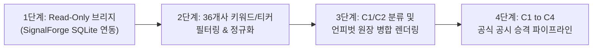

# [요건정의서] 36개사 언피벗 매트릭스 𝕏(Twitter) 시그널 연동 및 표출 규격

**문서 번호**: REQ-2026-10-11-TW-UNPIVOT  
**문서 버전**: v1.0.0  
**작성 일자**: 2026년 10월 11일  
**적용 대상**: `b_0917_10_QK_EARNING` (36개사 언피벗 매트릭스 및 실적 인텔리전스)  
**참조 시스템**: `c_1006_subject_outline` (SignalForge 자율 시그널 수집 엔진)  
**관련 문서**:  
- [docs/2026-10-11_SignalForge_Twitter_36개사_인텔리전스_연동_요건정의서.md](file:///Users/boon/Dropbox/03_code/b_0917_10_QK_EARNING/docs/2026-10-11_SignalForge_Twitter_36%EA%B0%9C%EC%82%AC_%EC%9D%B8%ED%85%94%EB%A6%AC%EC%A0%84%EC%8A%A4_%EC%97%B0%EB%8F%99_%EC%9A%94%EA%B1%B4%EC%A0%95%EC%9D%98%EC%84%9C.md)  
- [docs/2026-10-11_36entities_jul_aug_sep_oct_layer_matrix.md](file:///Users/boon/Dropbox/03_code/b_0917_10_QK_EARNING/docs/2026-10-11_36entities_jul_aug_sep_oct_layer_matrix.md)  
- [docs/2026-10-11_신뢰도_등급체계_및_C1루머_처리원칙.md](file:///Users/boon/Dropbox/03_code/b_0917_10_QK_EARNING/docs/2026-10-11_%EC%8B%A0%EB%A2%B0%EB%8F%84_%EB%93%B1%EA%B8%89%EC%B2%B4%EA%B3%84_%EB%B0%8F_C1%EB%A3%A8%EB%A8%B8_%EC%B2%98%EB%A6%AC%EC%9B%90%EC%B9%99.md)  

---

## 1. 배경 및 목적

### 1.1 추진 배경
- 현재 `10_QK_EARNING` 시스템은 AI 반도체 밸류체인 36개 기업의 4개 월(2026년 7·8·9·10월) 주요 사건을 [36개사 언피벗 원장](file:///Users/boon/Dropbox/03_code/b_0917_10_QK_EARNING/docs/2026-10-11_36entities_jul_aug_sep_oct_layer_matrix.md)으로 관리하고 있음.
- 현재 매트릭스 원장은 공식 공시(`C4`) 및 검증 언론 보도(`C3`) 위주로 구성되어 있어, **공식 공시 발표 전후 𝕏(Twitter) 인플루언서·소식통을 통해 급속도로 확산되는 초기 공급망 시그널 및 기술 루머(Early Radar)**의 실시간 포착에 시차가 발생함.
- 독립 시그널 수집 엔진인 `c_1006_subject_outline` (SignalForge)의 222개 마스터 인플루언서 타임라인 데이터를 안전하게 연동하여 언피벗 매트릭스에 통합 표출할 필요성이 대두됨.

### 1.2 핵심 목적
1. **조기 신호(Early Signal) 포착**: 공식 계약/공시 발표 수일~수주 전 발생하는 트위터 단독 발언 및 공급망 관측을 레이더 데이터로 확보.
2. **데이터 무결성 보장**: 미확인 루머(`C1`)가 유입되더라도 정규 통계(계약 총액 $B, 증설 캐파 MW/WSPM)가 오염되지 않도록 격리 및 표준화.
3. **언피벗 원장 규격 준수**: 기존 평탄화 원장(`[레이어] / [회사이름] / [발생일자] / [이벤트 내용] / [유형 & 신뢰도]`)과 100% 호환되는 데이터 매핑 체계 정립.

---

## 2. 시스템 아키텍처 및 연동 원칙

### 2.1 결합 원칙 (Decoupling Principles)
- **역할 분리**:
  - `c_1006_subject_outline` (SignalForge): 𝕏 계정 수집, 링크 본문 스텔스 스크래핑, 핫토픽 랭킹 산출 (수집 및 발견 전담).
  - `b_0917_10_QK_EARNING`: 36개 기업 엔티티 매핑, 계약/캐파/이정표 추출, 검증 및 C1~C4 승격, 언피벗 원장 렌더링.
- **무공유 쓰기 (No Shared Write)**: 두 시스템은 동일한 SQLite DB 파일에 동시 쓰기를 수행하지 않음.
- **장애 격리 (Fault Isolation)**: SignalForge의 크롤링 지연 또는 프로세스 다운이 `10_QK_EARNING` 대시보드 및 원장 서비스에 영향을 미치지 않아야 함.

### 2.2 데이터베이스 연동 방식 (MVP: Read-Only SQLite)
- `10_QK_EARNING`은 SignalForge의 `timeline.db`를 **읽기 전용(Read-Only URI)** 모드로 증분 조회(Incremental Pull)함.

```python
import sqlite3

def get_signalforge_connection():
    # Write Lock 방지 및 완전 격리를 위한 read-only URI 연결
    return sqlite3.connect(
        "file:../c_1006_subject_outline/data/timeline.db?mode=ro",
        uri=True,
        timeout=5.0
    )
```

---

## 3. 계정 등급 분류 및 36개사 카탈로그 확장

### 3.1 계정 등급 체계 (SignalForge 연계)
SignalForge의 P0/P1/P2는 **수집 우선순위(Priority)**이며 사실 신뢰도(Confidence)가 아님.

| 계정 등급 | 계정군 정의 | 권장 수집 주기 | 매트릭스 기본 취급 원칙 |
| :---: | :--- | :---: | :--- |
| **`O0`** | 기업 공식 IR, 정부(미 상무부, 대만 MOEA), 규제기관(SEC) | 15~60분 | 첨부 링크를 통해 **공식 원문(C4) 즉시 회수** 및 승격 |
| **`P0`** | 최고 권위 산업 분석가 (Dylan Patel, Dan Nystedt 등), 핵심 매체 | 1시간 | 정량 주장을 추출하여 **`C2` 또는 우선 검토 큐** 전송 |
| **`P1`** | 공급망 밸류체인 전문가, 부품사 엔지니어, 테크 인플루언서 | 4~12시간 | 복수 계정 교차 확인 시 **`C1` 레이더** 적재 |
| **`P2`** | FinTwit 매크로 계정, 루머 큐레이션, 커뮤니티 재인용 | 24시간 | 단독 인용 금지, 급증(Spike) 탐지 시에만 **`C1` 보류 큐** 적재 |

### 3.2 36개사 매핑 메타데이터 확장 규격 (`influencers.yaml`)
기존 222개 인플루언서 풀에 36개사 관련 태그 속성을 부여하여 매칭 정확도를 고도화함:

```yaml
- handle: "@dylan522p"
  name: "Dylan Patel"
  tier: "P0"
  source_role: "ANALYST"
  entity_ids:
    - "NVIDIA"
    - "TSMC"
    - "Broadcom"
    - "SK hynix"
  signal_domains:
    - "CONTRACT"
    - "FAB_CAPACITY"
    - "MILESTONE"
  languages: ["en"]
  enabled_for_qk_earning: true
  verified_hit_rate: 0.88
```

---

## 4. 언피벗 원장 테이블 컬럼 매핑 규격 (방안 A: 8열 구조)

현재 [36개사 언피벗 원장](file:///Users/boon/Dropbox/03_code/b_0917_10_QK_EARNING/docs/2026-10-11_36entities_jul_aug_sep_oct_layer_matrix.md)의 핵심 이벤트 테이블은 자연어 텍스트로부터 핵심 엔티티와 수치를 자동 추출하여 총 8개 열(Column)로 정규화합니다.

| 원장 컬럼 | 데이터 소스 및 변환 규칙 | 변환 및 표기 예시 |
| :--- | :--- | :--- |
| **1. 레이어 (Layer)** | 트윗/이벤트에서 탐지된 대상 기업의 소속 레이어 (`L1` ~ `L8`) 매핑 | `**L3 컴퓨팅/가속기**` |
| **2. 회사이름 (티커/국가)** | 캐시태그(`$NVDA`), 사명 정규식 매칭 및 표준 표기 변환 | `**NVIDIA** (NVDA 🇺🇸)` |
| **3. 발생일자 (Date)** | `timeline_events.published_at`의 날짜 추출 (`YYYY-MM-DD`) | `2026-07-28` |
| **4. 핵심 이벤트 내용 및 데이터** | `[𝕏 Radar] {작성자명}(@{핸들}): {핵심 주장 요약}` 형식 정형화 | `[𝕏 Radar] Dylan Patel(@dylan522p): Blackwell GB200 NVL72 랙 발열 이슈로 인한 1~2개월 패키징 마스크 보정 루머 제기` |
| **5. 식별 대상 (상대방·제품·시설)** | 텍스트 내 거래 상대방, 칩셋/아키텍처, 팹/데이터센터 시설 자동 파싱 | `상대: Broadcom \| 제품: 3nm Custom ASIC`<br>`상대: Constellation \| 시설: Crane 3마일 원전` |
| **6. 정량 조건 (금액·용량·물량·기간)** | 금액($B), 전력/증설 용량(MW/GW), 물량(만장/k units), 계약 기간 자동 구조화 | `금액: $65.0B \| 기간: 장기공급`<br>`용량: 835MW \| 기간: 20년 PPA` |
| **7. 이벤트 유형 (Type)** | 이벤트 성격 배지 및 유형 정의 | `⚠️ 루머`, `💬 분석가전망`, `📜 물품계약`, `🚩 마일스톤` |
| **8. 신뢰도 (Grade)** | 검증 등급 뱃지 단독 표기 (`[C1]` ~ `[C4]`) | `[C1]`, `[C2]`, `[C3]`, `[C4]` |

---

## 5. 신뢰도 등급(C1~C4) 및 데이터 무결성 보호 원칙

### 5.1 등급 부여 원칙
1. **`C1 (초기 루머 / Early Radar)`**:
   - 트위터 단독 포스팅, 커뮤니티 발 유출설, 단일 분석가의 미확인 트윗.
   - 유형: `⚠️ 루머` 또는 `💬 트위터` / 등급: `[C1]`.
2. **`C2 (보조 지표 / Reported)`**:
   - 복수의 P0/P1 분석가가 공통으로 언급하거나 대만 공급망(DigiTimes 등) 익명 인용 트윗.
   - 유형: `💬 분석가전망` 또는 `⚠️ 공급망속보` / 등급: `[C2]`.
3. **`C3 (검증 완료 / Verified)`**:
   - SemiAnalysis 유료 리포트, Bloomberg/Reuters 단독 보도 링크가 트윗에 포함되어 확인된 경우.
   - 유형: `📜 언론보도` / 등급: `[C3]`.
4. **`C4 (공식 확정 / Confirmed)`**:
   - 트윗에 SEC 8-K 링크, 기업 공식 IR 보도자료, 미 상무부 최종 서명 공문이 직접 포함된 경우.
   - 유형: `🚩 공식공시`, `📜 물품계약`, `⚡ 전력PPA` / 등급: `[C4]`.

### 5.2 수치 통계 무결성 보장 (Hard Constraint)
- **합산 배제**: `C1` 및 `C2`로 분류된 트위터 이벤트에 명시된 금액($B), 생산능력(WSPM, MW)은 **상단 KPI 카드 및 월별 통계 합계액에 일절 산입하지 않는다.**
- **추정치 라벨 강제**: 만약 금액이 언급된 경우 `($12.0B 추정)`과 같이 괄호 표기하여 확정 계약액과 구분한다.

---

## 6. 언피벗 원장 통합 표출 샘플 (방안 A: 8열 규격 예시)

다음은 실제 수집된 공시 및 트위터 레이더 시그널이 식별 대상과 정량 조건으로 분리되어 8열 원장에 삽입되는 구체적인 형태입니다:

| 레이어 (Layer) | 회사이름 (티커/국가) | 발생일자 (Date) | 핵심 이벤트 내용 및 데이터 | 식별 대상 (상대방·제품·시설) | 정량 조건 (금액·용량·물량·기간) | 이벤트 유형 (Type) | 신뢰도 (Grade) |
| :--- | :--- | :---: | :--- | :--- | :--- | :---: | :---: |
| **L1 AI 모델** | **OpenAI** (OAI 🇺🇸) | 2026-08-14 | [𝕏 Radar] SemiAnalysis(@dylan522p): 브로드컴과 공동 개발 중인 독자 AI ASIC 테이프아웃 임박설 제기 | 상대: Broadcom \| 제품: Custom AI ASIC | - | 💬 트위터 | `[C1]` |
| **L1 AI 모델** | **OpenAI** (OAI 🇺🇸) | 2026-09-10 | 브로드컴(Broadcom)과 3nm 맞춤형 커스텀 AI ASIC 공동개발·생산 계약 ($65.0B) | 상대: Broadcom \| 제품: 3nm Custom ASIC | 금액: $65.0B \| 기간: 장기공급 | 📜 물품계약 | `[C4]` |
| **L1 AI 모델** | **Anthropic** (ANTHROPIC 🇺🇸) | 2026-10-11 | [𝕏 Radar] SemiAnalysis(@SemiAnalysis_): The "Lambda–Anthropic" deal is really a four-party trade... Anthropic gets ~350 MW of Rubin... | 상대: Nvidia, Lambda, Hut 8 \| 제품: Rubin GPU | 용량: 350 MW \| 물량: 115K GPUs | 📜 언론보도 | `[C3]` |
| **L2 하이퍼스케일러** | **Microsoft** (MSFT 🇺🇸) | 2026-09-20 | 콘스텔레이션 3마일 원전(Crane) 835MW 직결 20년 PPA 최종 인허가 승인 | 상대: Constellation \| 시설: Crane 3마일 원전 | 용량: 835 MW \| 기간: 20년 PPA | ⚡ 전력PPA | `[C4]` |
| **L3 컴퓨팅/가속기** | **NVIDIA** (NVDA 🇺🇸) | 2026-07-28 | [𝕏 Radar] Dylan Patel(@dylan522p): GB200 NVL72 랙 발열 이슈로 인한 1~2개월 패키징 마스크 보정 루머 | 제품: GB200 NVL72 | - | ⚠️ 루머 | `[C1]` |
| **L3 컴퓨팅/가속기** | **NVIDIA** (NVDA 🇺🇸) | 2026-08-28 | Blackwell B200 마스크 재설계 완료 및 샘플 CSP 전달 공식 확인 (실적발표) | 제품: Blackwell B200 | - | 🚩 마일스톤 | `[C4]` |
| **L4 파운드리/제조** | **삼성전자** (005930 🇰🇷) | 2026-09-14 | 평택 P4 2nm 파운드리 파일럿 라인 웨이퍼 투입 및 장비 셋업 완료 | 시설: 평택 P4 \| 공정: 2nm 파운드리 | 단계: 파일럿 라인 가동 | 🚩 마일스톤 | `[C4]` |

---

## 7. 단계별 구현 로드맵



1. **1단계 (DB 브리지 구현)**:
   - `app/services/twitter_bridge.py` 신설
   - `../c_1006_subject_outline/data/timeline.db` 읽기 전용 접근 함수 작성
2. **2단계 (엔티티 필터링 & 추출)**:
   - 36개사 티커, 영문/한글 사명, 핵심 프로덕트(GB200, HBM3E, Trainium 등) 매칭 필터 구현
3. **3단계 (언피벗 매트릭스 UI 반영)**:
   - 언피벗 마크다운 원장 및 프론트엔드 대시보드에 `[⚠️ C1 루머 포함]` 필터 토글 지원
4. **4단계 (승격 관리 UI)**:
   - 트위터 C1 루머 중 후속 SEC 8-K 공시 또는 뉴스룸 확인 시 원클릭 `C4` 승격 지원
