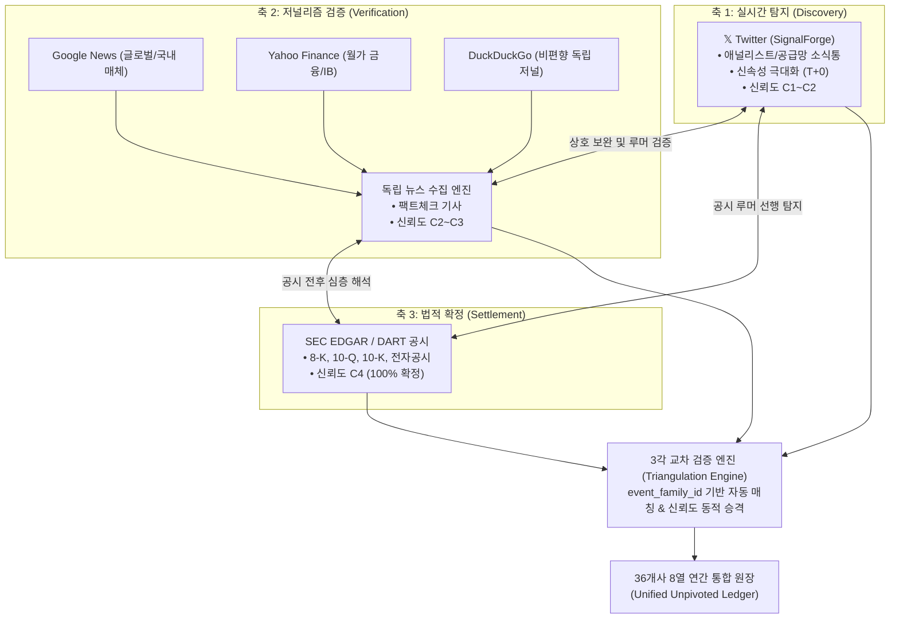
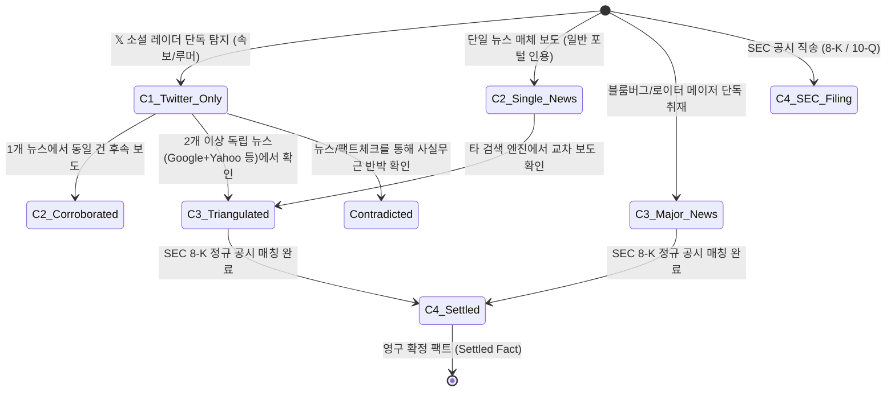
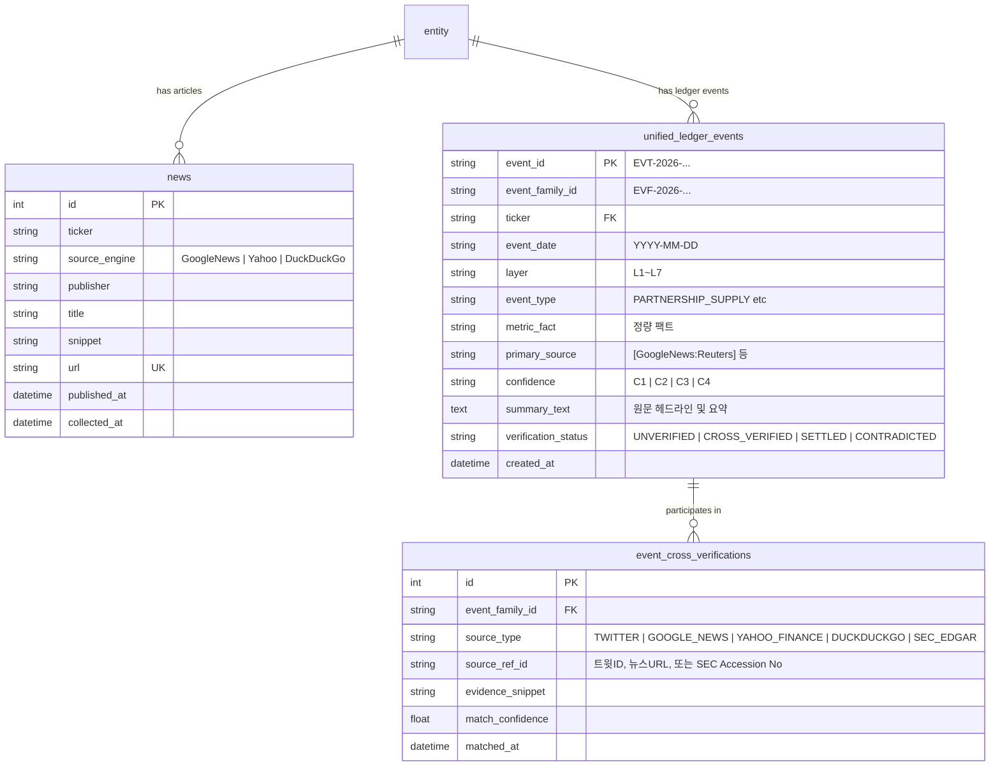

# ****36개사 연간 통합 원장 — 다중 뉴스 검색(Google, Yahoo, DuckDuckGo) 독립 수집 및 트위터·공시 상호 교차검증 요건정의서

> **문서 번호**: SPEC-2026-LEDGER-NEWS-TRIANGULATION-01
> **작성 일자**: 2026년 10월 11일
> **상태**: Draft / Specification Ready
> **관련 문서**:
> • [docs/2026-10-11_36entities_2026_full_year_layer_matrix.md](file:///Users/boon/Dropbox/03_code/b_0917_10_QK_EARNING/docs/2026-10-11_36entities_2026_full_year_layer_matrix.md) (1,215건 통합 원장)
> • [docs/2026-10-11_36개사_언피벗_매트릭스_트위터_시그널_연동_요건정의서.md](file:///Users/boon/Dropbox/03_code/b_0917_10_QK_EARNING/docs/2026-10-11_36%EA%B0%9C%EC%82%AC_%EC%96%B8%ED%94%BC%EB%B2%97_%EB%A7%A4%ED%8A%B8%EB%A6%AD%EC%8A%A4_%ED%8A%B8%EC%9C%84%ED%84%B0_%EC%8B%9C%EA%B7%B8%EB%84%80_%EC%97%B0%EB%8F%99_%EC%9A%94%EA%B1%B4%EC%A0%95%EC%9D%98%EC%84%9C.md)
> • [docs/2026-10-11_신뢰도_등급체계_및_C1루머_처리원칙.md](file:///Users/boon/Dropbox/03_code/b_0917_10_QK_EARNING/docs/2026-10-11_%EC%8B%A0%EB%A2%B0%EB%8F%84_%EB%93%B1%EA%B8%89%EC%B2%B4%EA%B3%84_%EB%B0%8F_C1%EB%A3%A8%EB%A8%B8_%EC%B2%98%EB%A6%AC%EC%9B%90%EC%B9%99.md)
> • [docs/2026-10-11_36개사_언피벗_원장_수동데이터_입력양식_및_프롬프트_요건정의서.md](file:///Users/boon/Dropbox/03_code/b_0917_10_QK_EARNING/docs/2026-10-11_36%EA%B0%9C%EC%82%AC_%EC%96%B8%ED%94%BC%EB%B2%97_%EC%9B%90%EC%9E%A5_%EC%88%98%EB%8F%99%EB%8D%B0%EC%9D%B4%ED%84%B0_%EC%9E%85%EB%A0%A5%EC%96%91%EC%8B%9D_%EB%B0%8F_%ED%94%84%EB%A1%AC%ED%94%84%ED%8A%B8_%EC%9A%94%EA%B1%B4%EC%A0%95%EC%9D%98%EC%84%9C.md)

---

## 1. 배경 및 목적 (Background & Objectives)

### 1.1 배경 및 문제의식

1. **단일 채널 의존의 한계**:
   - 기존의 트위터(𝕏, SignalForge) 중심 소셜 인텔리전스는 빠른 속도와 현장 감각(공급망 루머, 속보)을 제공하지만, 단일 인플루언서 피드에 의존할 경우 허위 사실(C1 루머), 노이즈, 알고리즘 편향에 취약함.
2. **SEC 공시의 지연성(Latency)**:
   - 정규 SEC 공시(10-K, 10-Q, 8-K)는 100% 신뢰성(`C4 Confirmed`)을 담보하지만, 사건 발생 후 수일~수개월 뒤에 공개되므로 선행 투자 판단을 내리는 데 시차가 큼.
3. **독립적 다중 뉴스 검색 엔진의 필요성**:
   - 구글 뉴스(Google News), 야후 파이낸스(Yahoo Finance), 덕덕고(DuckDuckGo) 3대 검색 엔진을 독립 가동하여, 트위터나 SEC 공시와는 완전히 무관한 독자적인 뉴스 이벤트를 8열 원장 규격으로 생성할 필요가 있음.
4. **상호 보완 검증 (3각 검증 / Triangulation)의 가치**:
   - **소셜 시그널(Twitter)**, **저널리즘 팩트체크(Multi-News)**, **법적 공시(SEC EDGAR)**의 3대 축이 유기적으로 결합되어, "루머 포착 $\rightarrow$ 언론 보도 교차 검증 $\rightarrow$ 공시 확정"으로 이어지는 신뢰도 전이 및 상호 보완 검증 체계를 확립함.



---

## 2. 3대 독립 뉴스 검색 엔진별 수집 정책

각 검색 엔진은 서로 다른 크롤링 알고리즘, 언론사 커버리지, 데이터 가공 방식을 가지므로 상호 배타적이면서도 보완적인 데이터셋을 확보합니다.

### 2.1 엔진별 특성 및 수집 채널


| 검색 엔진         | 수집 채널 / 프로토콜                                                                        | 주력 커버리지 및 강점                                                                                                                                  | 수집 주기 |         초기 부여 신뢰도         |
| :---------------- | :------------------------------------------------------------------------------------------ | :----------------------------------------------------------------------------------------------------------------------------------------------------- | :-------: | :-------------------------------: |
| **Google News**   | • RSS Search Feed API<br>• `hl=en-US&gl=US`, `hl=ko&gl=KR`                                | • 글로벌 5만+ 언론사 네트워크<br>• 토픽 클러스터링 및 시간대별 이슈 집계<br>• 국내 주요 경제지(매경, 한경 등) 커버                                  |   30분   | `C2` (일반)<br>`C3` (메이저 단독) |
| **Yahoo Finance** | • RSS 2.0 Headline Feed<br>• `feeds.finance.yahoo.com`<br>• US Ticker 기반 다이렉트 쿼리 | • 블룸버그, 로이터, 다우존스, 배런스 등 월가 금융 기사 직송<br>• M&A, 분기 실적 가이던스, 주가 충격, 애널리스트 투자의견                             |   30분   |    `C3` (월가 전문 IB/통신사)    |
| **DuckDuckGo**    | • DuckDuckGo News HTML API / Lite Search<br>• `duckduckgo_search` 모듈 연동               | • 개인화·쿠키 편향 없는 중립 검색 결과<br>• 유료 광고나 대형 포털 우선 노출 배제<br>• Tom's Hardware, AnandTech 등 전문 테크 블로그/인디 매체 발굴 |   60분   |        `C2` (독립 미디어)        |

### 2.2 독립 실행 원칙 (Independent Decoupling)

- **Twitter 의존 제로**: 트위터 API 차단, 로그인 정책 변경, 계정 정지 여부와 상관없이 뉴스 수집기는 독자적으로 크롤링 및 파싱을 수행함.
- **Failover 격리**: 특정 엔진(예: Google News RSS)에서 일시적인 429 Rate Limit이 발생해도 Yahoo Finance와 DuckDuckGo 엔진은 정상 작동함.
- **수집 테이블 분리 및 보관**: 원본 기사는 `news` 테이블에 저장되고, 8열 원장 이벤트 규격으로 정제된 데이터는 `unified_ledger_events`로 승격됨.

---

## 3. 8열 연간 통합 원장 (Plan A) 표준 규격 매핑

뉴스 수집기가 포착한 기사는 LLM/정규식 기반 엔티티 추출기를 거쳐 기존 **Plan A 8열 표준 원장 스키마**로 자동 변환되어 적재됩니다.

### 3.1 8열 원장 매핑 필드 정의


| 컬럼 순서 | 컬럼명 (Plan A) | 뉴스 데이터 변환 규칙                             | 예시 데이터                                                                                    |
| :-------: | :-------------- | :------------------------------------------------ | :--------------------------------------------------------------------------------------------- |
|   **1**   | **날짜**        | 기사 발행 일자 (`YYYY-MM-DD`)                     | `2026-09-18`                                                                                   |
|   **2**   | **티커**        | 기사 대상 36개사 티커                             | `NVDA`, `000660.KS`, `VRT`                                                                     |
|   **3**   | **레이어**      | 36개사 기본 소속 레이어 (L1~L7)                   | `L1 GPU/AI칩`, `L2 HBM/메모리`                                                                 |
|   **4**   | **이벤트유형**  | 기사 본문 분석을 통한 표준 이벤트 태그            | `PARTNERSHIP_SUPPLY`, `CAPEX_EXPANSION`, `REGULATION_GEO`, `TECH_BREAKTHROUGH`                 |
|   **5**   | **수치/팩트**   | 본문 내 명시된 정량 수치 정규화 추출              | `$5.2B 규모`, `25k WSPM 증설`, `500MW PPA 서명`                                                |
|   **6**   | **소스**        | `[엔진:매체명]` 표준 포맷 표기                    | `[GoogleNews:Reuters]`, `[Yahoo:Bloomberg]`, `[DDG:Tom'sHardware]`                             |
|   **7**   | **신뢰도**      | 1차 수집 시 엔진/매체 등급에 따라 C2~C3 자동 부여 | `C3` (로이터 단독), `C2` (일반 포털 인용)                                                      |
|   **8**   | **원문/비고** | 기사 헤드라인 + 핵심 요약 2~3문장 + 기사 링크 URL | `엔비디아, B200 랙 발열 문제 해결 완료 및 4분기 공급 가속화 발표. (출처: 로이터, https://...)` |

### 3.2 8열 원장 데이터 생성 예시 (Markdown/DB Row)

```markdown
| 2026-09-18 | NVDA | L1 GPU/AI칩 | PARTNERSHIP_SUPPLY | $5.2B 공급 계약 체결 | [Yahoo:Bloomberg] | C3 | 엔비디아-오라클, 차세대 OCI 슈퍼클러스터용 GB200 NVL72 랙 2,000기 추가 공급 본계약 체결 보도. (https://bloomberg.com/...) |
| 2026-10-04 | 000660.KS | L2 HBM/메모리 | CAPEX_EXPANSION | 3.1조원 M15X 조기 장비 반입 | [GoogleNews:한국경제] | C3 | SK하이닉스 청주 M15X 팹 HBM4 전용 라인 구축을 위한 핵심 극자외선(EUV) 노광기 조기 반입 착수. (https://hankyung.com/...) |
| 2026-10-09 | VRT | L7 전력/인프라 | TECH_BREAKTHROUGH | 150kW/Rack 냉각수 분배 장치 상용화 | [DDG:DataCenterDynamics] | C2 | 버티브, 차세대 메가와트 데이터센터용 고밀도 직접액체냉각(DLC) CoolTera 150kW 솔루션 글로벌 출시. (https://datacenterdynamics.com/...) |
```

---

## 4. 상호 보완 및 3각 교차검증 (Triangulation) 메커니즘

트위터, 다중 뉴스, SEC 공시가 상호 보완적으로 작동하도록 **이벤트 패밀리(`event_family_id`)** 기반 클러스터링과 **신뢰도 전이 엔진**을 정의합니다.

### 4.1 3각 교차 검증 상태 전이도



### 4.2 이벤트 패밀리 (`event_family_id`) 생성 및 유사도 매칭 규칙

복수의 서로 다른 출처에서 동일 사건을 다루고 있음을 식별하기 위해 다음 3단계 알고리즘을 적용합니다:

1. **1단계: 하드 필터링 (Hard Filtering)**:
   - **티커 일치**: 대상 기업 티커가 동일해야 함 (또는 공급자-수요자 밸류체인 관계 매핑).
   - **타임 윈도우(Time Window)**: 사건 발생일 기준 **$\pm 5$일 이내**의 이벤트 대상.
2. **2단계: 엔티티 및 정량 키워드 교집합 (Entity & Metric Overlap)**:
   - 수치 유사도: 금액($B), 물량(WSPM, MW), 모델명(GB200, HBM4, B300)이 $80\%$ 이상 일치.
   - 키워드 매칭: `공급계약`, `지연`, `증설`, `발열`, `인수` 등 핵심 트리거 키워드 공유.
3. **3단계: LLM 교차 검증 판정 (Triangulation Arbiter)**:
   - 유사도 점수가 $0.75$ 이상인 이벤트 쌍을 묶어 `event_family_id` (예: `EVF-2026-NVDA-B200HEAT`) 부여.
   - 판정 결과에 따라 상태 코드 기록:
     - `CORROBORATED` (상호 일치/보강)
     - `CONTRADICTED` (상호 모순/반박 보도)
     - `INDEPENDENT` (완전히 별개의 독립 사건)

### 4.3 신뢰도 등급 승격 및 보완 규칙


| 시나리오 |   𝕏 트위터 시그널   | 다중 뉴스 검색 엔진 (Google / Yahoo / DDG) |       SEC EDGAR 공시       | 최종 판정 등급 | 비고 / 시스템 동작                                                                         |
| :------: | :------------------: | :----------------------------------------: | :-------------------------: | :------------: | :----------------------------------------------------------------------------------------- |
|  **A**  |   단독 포스팅 포착   |               보도 내역 없음               |          공시 없음          |    **`C1`**    | • 원장 기본 뷰에서는 숨김 처리<br>• `⚠️ Early Radar` 필터에서만 표시                   |
|  **B**  |   단독 포스팅 포착   |       **Google News 1건 보도 확인**       |          공시 없음          |    **`C2`**    | •`C1` $\rightarrow$ `C2` 승격<br>• "단일 언론 보도 확인" 뱃지 표출                       |
|  **C**  |   단독 포스팅 포착   | **Google News + Yahoo Finance 동시 보도** |          공시 없음          |    **`C3`**    | •`C1` $\rightarrow$ **`C3 (교차검증 완료)`** 자동 승격<br>• 정규 원장 테이블에 정식 노출 |
|  **D**  | 포스팅 없음 (미탐지) |   **Bloomberg / Reuters 단독 특종 보도**   |          공시 없음          |    **`C3`**    | •**뉴스가 트위터를 선제 보완**<br>• 원장에 뉴스 기반 신규 이벤트 자동 등록               |
|  **E**  |   루머 존재 (`C1`)   |   **팩트체크 기사에서 "사실무근" 확인**   |        반박 보도자료        | **`REJECTED`** | •`🔴 반박됨(Contradicted)` 뱃지 부여<br>• 원장 취소선 처리 및 반박 기사 링크             |
|  **F**  | 사전 루머/보도 있음 |         뉴스 보도 다수 존재 (`C3`)         | **8-K 주요 사건 공시 등록** |    **`C4`**    | •**`C4 (공식 확정)`** 최종 승격<br>• 법적 팩트로서 계약 총액/투자 통계에 100% 반영       |

---

## 5. 데이터베이스 스키마 및 저장 아키텍처

SQLite3 기반 로컬 DB(`data/qk_earning.db`)에 신규 교차 검증 테이블과 원장 통합 테이블을 정의합니다.



### 5.1 테이블 DDL 정의

```sql
-- 1. 통합 원장 이벤트 테이블 (트위터, 뉴스, SEC 수렴 원장)
CREATE TABLE IF NOT EXISTS unified_ledger_events (
    event_id TEXT PRIMARY KEY,               -- 예: EVT-20260918-NVDA-01
    event_family_id TEXT NOT NULL,          -- 예: EVF-2026-NVDA-B200HEAT
    ticker TEXT NOT NULL,                   -- 36개사 티커
    event_date TEXT NOT NULL,               -- YYYY-MM-DD
    layer TEXT NOT NULL,                    -- L1 GPU/AI칩 ~ L7 전력/인프라
    event_type TEXT NOT NULL,               -- PARTNERSHIP_SUPPLY 등
    metric_fact TEXT,                       -- $5.2B 규모 등 정량 지표
    primary_source TEXT NOT NULL,           -- [GoogleNews:Reuters], @pequityresearch 등
    confidence TEXT NOT NULL DEFAULT 'C2',  -- C1, C2, C3, C4
    summary_text TEXT NOT NULL,             -- 요약 및 기사 원문
    url TEXT,                               -- 원문 링크
    verification_status TEXT NOT NULL DEFAULT 'UNVERIFIED', -- UNVERIFIED, CROSS_VERIFIED, SETTLED, CONTRADICTED
    created_at TIMESTAMP DEFAULT CURRENT_TIMESTAMP,
    updated_at TIMESTAMP DEFAULT CURRENT_TIMESTAMP
);

CREATE INDEX IF NOT EXISTS idx_ule_ticker_date ON unified_ledger_events(ticker, event_date);
CREATE INDEX IF NOT EXISTS idx_ule_family ON unified_ledger_events(event_family_id);
CREATE INDEX IF NOT EXISTS idx_ule_confidence ON unified_ledger_events(confidence);

-- 2. 상호 교차 검증 매핑 테이블 (Triangulation Evidence)
CREATE TABLE IF NOT EXISTS event_cross_verifications (
    id INTEGER PRIMARY KEY AUTOINCREMENT,
    event_family_id TEXT NOT NULL,
    source_type TEXT NOT NULL,              -- TWITTER, GOOGLE_NEWS, YAHOO_FINANCE, DUCKDUCKGO, SEC_EDGAR
    source_ref_id TEXT NOT NULL,            -- 트윗 ID, 기사 URL, SEC Accession Number
    publisher_name TEXT,                    -- Reuters, Bloomberg, SemiAnalysis 등
    evidence_snippet TEXT NOT NULL,         -- 증빙 문장/문맥
    match_confidence REAL DEFAULT 1.0,     -- 매칭 신뢰도 (0.0 ~ 1.0)
    matched_at TIMESTAMP DEFAULT CURRENT_TIMESTAMP
);

CREATE INDEX IF NOT EXISTS idx_ecv_family ON event_cross_verifications(event_family_id);
```

---

## 6. 대시보드 UI 및 사용자 경험 (UX) 요건

### 6.1 상단 필터 바 (Filter Bar) 확장

기존의 원장 뷰어(`static/index.html`) 상단 툴바에 출처별 및 검증 상태별 멀티 필터를 추가합니다.

1. **출처별 탭 버튼**:
   - `[ 전체 (All) ]`
   - `[ 𝕏 트위터 시그널 ]`
   - `[ 📰 3대 독립 뉴스 ]` (Google, Yahoo, DuckDuckGo)
   - `[ 🏛️ SEC 정규 공시 ]`
2. **검증 상태 필터**:
   - `[ 🟢 3각 검증 완료 (Triangulated) ]`: 트위터 + 2개 이상 뉴스 매체 확인
   - `[ 🟡 언론 보도 완료 (News Verified) ]`: 뉴스 매체 교차 확인
   - `[ ⚪ 단독 루머 포함 (Include Early C1) ]`: C1 미확인 시그널 노출 여부 토글

### 6.2 8열 원장 테이블 내 시각적 뱃지 및 표시 사양


| 상태               | 표시 뱃지            | 시각적 스타일                | 툴팁 설명                                                           |
| :----------------- | :------------------- | :--------------------------- | :------------------------------------------------------------------ |
| **3각 검증 완료**  | `🟢 [3각검증 C3]`    | 녹색 글로우 뱃지 (`#10b981`) | "𝕏 트위터 루머 포착 후 Google, Yahoo News에서 팩트 교차 확인 완료" |
| **언론 교차 검증** | `🟡 [뉴스확인 C3]`   | 황색 뱃지 (`#f59e0b`)        | "Google News 및 DuckDuckGo 2개 이상 독립 매체 보도 완료"            |
| **SEC 공시 확정**  | `🏛️ [공식확정 C4]` | 청색 볼드 뱃지 (`#3b82f6`)   | "SEC EDGAR 8-K/10-Q 법적 공시 매칭 완료 (100% 확정)"                |
| **트위터 단독**    | `⚪ [소셜단독 C1]`   | 회색 점선 뱃지 (`#64748b`)   | "소셜 미디어 단독 포착 (언론 미보도 미검증 상태)"                   |
| **상호 반박/기각** | `🔴 [반박보도]`      | 적색 취소선 뱃지 (`#ef4444`) | "트위터 루머에 대해 메이저 언론에서 사실무근 반박 보도 게재"        |

### 6.3 "3각 검증 인스펙터 (Triangulation Inspector)" 모달 뷰어

원장 행(Row) 클릭 시, 3각 출처의 증빙 데이터를 3개 패널로 나란히 비교하는 모달 창을 제공합니다:

```text
+----------------------------------------------------------------------------------------------------+
| 🔍 [3각 교차 검증 인스펙터] NVDA - 2026-09-18 GB200 공급 및 발열 이슈 해결                            |
| Event Family ID: EVF-2026-NVDA-B200HEAT                    최종 승격 신뢰도: C3 (Verified)        |
+------------------------------------+----------------------------------+----------------------------+
| 𝕏 Twitter 소셜 레이더 (T-3일)      | 📰 3대 뉴스 교차 보도 (T-0일)       | 🏛️ SEC 공시 / 공식 IR (T+5일) |
+------------------------------------+----------------------------------+----------------------------+
| @pequityresearch (09-15):          | [Google:Reuters] (09-18):        | SEC 8-K Filing (09-23):    |
| "엔비디아 대만 ODM 공급망 확인 결과    | "엔비디아, B200 랙 발열 개선판    | "Item 8.01 Other Events:   |
| B200 서버 랙 냉각 블록 재설계 완료,  | 대량 양산 승인 완료... 분기 내    | 차세대 가속기 랙 출하 일정   |
| 10월 본격 출하 일정 정상화 전망."  | 4만 대 인도 목표."               | 정상화 확약."              |
|                                    |                                  |                            |
| @dnystedt (09-16):                 | [Yahoo:Bloomberg] (09-18):       | [IR 보도자료]:             |
| "TSMC CoWoS-L 물량 배정 재조정...  | "오라클 및 MS 향 GB200 납품      | "공식 보도자료 PDF 링크"   |
| 4분기 출하 목표치 30% 상향."       | 가속화 공식 확인."               |                            |
+------------------------------------+----------------------------------+----------------------------+
| 결론 및 판정: 트위터 선행 루머 100% 사실 부합 (3각 교차검증 성공, C1 -> C3 승격)                   |
+----------------------------------------------------------------------------------------------------+
```

---

## 7. 수집기(Collector) 확장 구현 사양

### 7.1 DuckDuckGo 뉴스 수집기 추가 사양 (`duckduckgo_search` 모듈)

`app/services/news_collector.py`에 DuckDuckGo 뉴스 엔드포인트를 추가합니다.

```python
def fetch_duckduckgo_news(self, query: str, max_results: int = 15) -> List[Dict[str, Any]]:
    """
    Fetch news from DuckDuckGo search without cookie/tracker bias.
    Uses DDGS().news(keywords, region='wt-wt', safesearch='off', timelimit='m')
    """
    results = []
    try:
        from duckduckgo_search import DDGS
        with DDGS() as ddgs:
            ddg_gen = ddgs.news(query, region="wt-wt", safesearch="off", timelimit="m", max_results=max_results)
            for r in ddg_gen:
                results.append({
                    "title": self._clean_text(r.get("title")),
                    "link": r.get("url"),
                    "published": self._parse_pub_date(r.get("date")),
                    "snippet": self._clean_text(r.get("body"))[:300],
                    "source": r.get("source") or "DuckDuckGo",
                    "engine": "DuckDuckGo"
                })
    except Exception as e:
        # Gracefully handle network or package import exceptions
        pass
    return results
```

### 7.2 36개사 정밀 쿼리 템플릿

단순 티커 검색 시 발생하는 노이즈를 방지하기 위해 밸류체인 핵심 키워드를 결합한 정밀 쿼리 맵을 운용합니다.

```python
SEARCH_QUERY_MAP = {
    # L1: GPU & 가속기
    "NVDA": 'NVIDIA (Blackwell OR "GB200" OR "B200" OR "B300" OR Capex OR 공급계약)',
    "AMD": 'AMD ("MI300X" OR "MI325X" OR "MI350" OR ROCm OR 수주)',
    "AVGO": 'Broadcom ("Custom ASIC" OR XPU OR Tomahawk OR 파트너십)',
    # L2: HBM & 메모리
    "000660.KS": 'SK하이닉스 ("HBM3E" OR "HBM4" OR M15X OR 용인팹 OR 양산)',
    "005930.KS": '삼성전자 ("HBM3E" OR 파운드리 OR 평택P4 OR 테일러팹)',
    "MU": 'Micron ("HBM3E 12단" OR "HBM4" OR 보이시팹 OR CapEx)',
    # L3: 파운드리 & 패키징
    "TSM": 'TSMC ("CoWoS" OR "A16" OR "2nm" OR 애리조나팹 OR 가동률)',
    # L7: 전력 & 인프라
    "VRT": 'Vertiv ("Liquid Cooling" OR 액체냉각 OR "DLC" OR 수주잔고)',
    "ETN": 'Eaton (변압기 OR 배전반 OR 데이터센터 OR 전력인프라)'
}
```

---

## 8. 실행 및 운영 스케줄링 정책

1. **배치 수집 주기**:
   - **Google News RSS**: 30분 주기 배치 (최신 40개 기사 폴링)
   - **Yahoo Finance RSS**: 30분 주기 배치 (미국 티커 전수 폴링)
   - **DuckDuckGo News**: 60분 주기 배치 (심층 밸류체인 쿼리 폴링)
2. **Rate Limit 준수**:
   - 구글 뉴스: 요청 간 딜레이 `0.2초`
   - 야후 파이낸스: 요청 간 딜레이 `0.3초`
   - 덕덕고 뉴스: 요청 간 딜레이 `0.5초` (차단 방지 헤더 순환)
3. **중복 제거 (Deduplication)**:
   - 기사 URL의 캐노니컬 정규화 (`utm_*` 추적 파라미터 완전 제거)
   - 헤드라인 텍스트 자카드 유사도(Jaccard Similarity) $85\%$ 이상 기사는 대표 기사 1건으로 자동 압축

---

## 9. 기대 효과 및 도입 이점

1. **정보 무결성 극대화**: 트위터 단독 피드의 가짜 뉴스/허위 수주 루머에 따른 포트폴리오 왜곡을 원천 차단.
2. **사각지대 없는 모니터링**:
   - 트위터가 다루지 않는 정부 정책/관세/특허 분쟁은 **Google/DuckDuckGo**가 포착.
   - 뉴스가 다루지 않는 현장 엔지니어/공급망 소식통 정보는 **Twitter**가 선제 포착.
3. **투자 의사결정의 명확성**: "루머 $\rightarrow$ 복수 언론 보도 $\rightarrow$ 정규 공시"로 이어지는 이벤트 라이프사이클을 8열 원장에서 한눈에 추적 가능.
