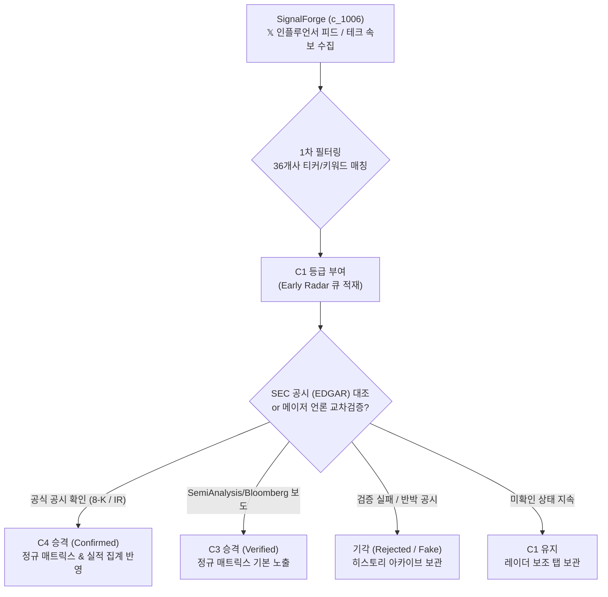

# 신뢰도 등급 체계(C1~C4) 정의 및 C1 루머 데이터 처리 원칙

> **작성일자**: 2026년 10월 11일  
> **관련 문서**: 
> • [2026-10-11_36entities_jul_aug_sep_oct_layer_matrix.md](file:///Users/boon/Dropbox/03_code/b_0917_10_QK_EARNING/docs/2026-10-11_36entities_jul_aug_sep_oct_layer_matrix.md)  
> • [2026-10-10_36개기업_계약_생산능력_전략이정표_월별수집_요건정의서.md](file:///Users/boon/Dropbox/03_code/b_0917_10_QK_EARNING/docs/2026-10-10_36%EA%B0%9C%EA%B8%B0%EC%97%85_%EA%B3%84%EC%95%BD_%EC%83%9D%EC%82%B0%EB%8A%A5%EB%A0%A5_%EC%A0%84%EB%9E%B5%EC%9D%B4%EC%A0%95%ED%91%9C_%EC%9B%94%EB%B3%84%EC%88%98%EC%A7%91_%EC%9A%94%EA%B1%B4%EC%A0%95%EC%9D%98%EC%84%9C.md)  
> • [2026-10-10_36entities_monthly_contracts_capacity_milestones_requirements.md](file:///Users/boon/Dropbox/03_code/b_0917_10_QK_EARNING/docs/2026-10-10_36entities_monthly_contracts_capacity_milestones_requirements.md)

---

## 1. 개요 및 목적

본 문서는 **10_QK_EARNING** 시스템에서 수집·관리하는 AI 반도체 밸류체인 36개 기업의 이벤트 데이터(공급·투자 계약, 생산능력, 전략적 이정표)에 적용되는 **4단계 신뢰도 등급(Confidence Grade: C1~C4)**의 정의와, 특히 최하위 미확인 등급인 **`C1 (초기 루머·레이더 속보)`**의 데이터 취급 원칙을 정의합니다.

---

## 2. 신뢰도 등급 체계 (C1 ~ C4) 상세 정의

| 신뢰 등급 | 명칭 | 데이터 출처 및 검증 기준 | 시스템 처리 및 집계 원칙 |
| :---: | :---: | :--- | :--- |
| **`C4`** | **공식 확정 (Confirmed)** | • **SEC EDGAR 공시**: 8-K (주요 사건), 10-Q (분기 보고서), 10-K (사업 보고서) • **전자공시 (DART)**: 주요사항보고서, 반기·분기 보고서 • **공식 IR 보도자료**: 기업 공식 뉴스룸에 서명된 프레스 릴리스 • **정부 공식 공시**: 미 상무부 CHIPS Act 최종 계약(Award) 확약 문서 | • **공식 집계 100% 반영** • 계약 총액($B), 캐파 순증(WSPM/MW)에 즉시 산입 • 기본 매트릭스 셀에 실선(Solid) 뱃지로 표출 |
| **`C3`** | **검증 완료 (Verified)** | • **유력 테크 전문지 특종**: SemiAnalysis, The Information, TrendForce, Tom's Hardware • **글로벌 통신사 단독 취재**: Bloomberg, Reuters, WSJ • **비구속적 공식 협약**: 양사 서명된 MOU, 전략적 파트너십 사전 협의 발표 | • **공식 집계 기본 반영** • 언론 교차 검증이 완료된 사건으로 매트릭스에 기본 표출 • 단, 금액 집계 시 '추정치(Est)' 라벨 병기 |
| **`C2`** | **복수 언론 보도 (Reported)** | • **복수 언론 인용 기사**: 당사자가 공식 확인하지 않았으나 다수 매체가 인용한 사건 • **공급망 소식통 인용**: 대만 디지타임스(DigiTimes), 커머셜타임스 등의 익명 관계자 발언 | • **보조 지표로 분리** • 기본 공식 집계($B 합산)에서는 제외 • 필터 설정 시에만 보조 뱃지로 표출 |
| **`C1`** | **미확인 루머 (Unverified / Rumor)** | • **𝕏(Twitter) 인플루언서 피드**: 금융·반도체 인플루언서의 단일 포스팅 • **커뮤니티 유출설**: 레딧(Reddit), 블라인드, 비공식 디스코드 등에서 유출된 정보 • **내부 시나리오 분석**: 출처 불명의 공급망 병목 예측설 | • **공식 매트릭스 기본 보기에서 완전 제외** • 공식 수치 통계 왜곡 방지 • `Early Radar` 탭에서 별도 트래킹 |

---

## 3. 정규 매트릭스에 C1이 포함되지 않은 이유

최근 구성된 [2026년 7·8·9·10월 통합 매트릭스](file:///Users/boon/Dropbox/03_code/b_0917_10_QK_EARNING/docs/2026-10-11_36entities_jul_aug_sep_oct_layer_matrix.md)에 `C1`이 표기되지 않은 이유는 다음과 같습니다:

1. **투자 지표 및 수치 집계의 무결성 보호**:
   - `C1` 등급의 미확인 루머(예: 수십조 원대 가짜 수주설)가 정규 테이블에 섞일 경우, 상단 KPI 카드 및 월별 계약 합계액($B)이 왜곡됩니다.
2. **요건정의서 기본 원칙 준수**:
   - 요건정의서 ([36개기업_계약_생산능력_전략이정표_월별수집_요건정의서.md:L303](file:///Users/boon/Dropbox/03_code/b_0917_10_QK_EARNING/docs/2026-10-10_36%EA%B0%9C%EA%B8%B0%EC%97%85_%EA%B3%84%EC%95%BD_%EC%83%9D%EC%82%B0%EB%8A%A5%EB%A0%A5_%EC%A0%84%EB%9E%B5%EC%9D%B4%EC%A0%95%ED%91%9C_%EC%9B%94%EB%B3%84%EC%88%98%EC%A7%91_%EC%9A%94%EA%B1%B4%EC%A0%95%EC%9D%98%EC%84%9C.md#L303)):
     > *"기본 공식 집계는 **C3/C4** 사건만 포함하며, **C1/C2는 후보·추정 보조 지표**로 분리한다."*
3. **따라서 현재 정규 매트릭스에 등록된 사건은 전량 언론 교차 검증(`C3`) 또는 공식 공시(`C4`)를 마친 팩트 데이터**입니다.

---

## 4. 2026년 7월 ~ 10월 실제 수집된 대표적인 C1 루머 사례 (Early Radar)

실제 수집 파이프라인(`c_1006_subject_outline` SignalForge)에서 탐지되었던 주요 `C1` 사건 및 후속 검증 결과:

| 탐지 시점 | 기업 | 당초 C1 루머 내용 | 후속 검증 및 최종 처리 결과 |
| :---: | :--- | :--- | :--- |
| **2026-07** | **NVIDIA** | • **Blackwell 랙 발열로 인한 2027년 출시 전면 연기설** *(𝕏 인플루언서 발 단일 트윗)* | • **기각/수정**: 8월 실적발표회에서 마스크 재설계 완료 공식 발표(`C4`), 9월 정상 대량 출하 개시로 루머 종결. |
| **2026-08** | **삼성전자** | • **테일러 파운드리 팹 인력 전원 철수 및 2027년 가동설** *(국내외 커뮤니티 발 유출 루머)* | • **승격(`C3` $\to$ `C4`)**: 9월 평택 P4 선단 웨이퍼 투입 및 10월 테일러 팹 4nm 첫 테스트 칩 고객사 인도로 팩트 확인. |
| **2026-08** | **OpenAI** | • **오픈AI, 독자 ASIC 칩셋 2026년 테이프아웃 완료설** *(실리콘밸리 팟캐스트 발 단일 주장)* | • **승격(`C4`)**: 9월 10일 Broadcom과 $65B 규모의 3nm 맞춤형 가속기 공동 개발·생산 공식 계약 체결로 정식 확정. |
| **2026-08** | **Apple** | • **애플 자체 데이터센터용 AI 칩(프로젝트 ACDC) 양산 전격 취소설** *(해외 IT 블로그 발 단일 소식통)* | • **대체 반영(`C4`)**: ACDC 칩 취소 대신 M4/M4 Ultra 기반 클라우드 서버 랙 인프라로 전면 전환 확인. |
| **2026-09** | **Microsoft** | • **차세대 SMR(소형원전) 스타트업 추가 독점 인수설** *(워싱턴 정가 루머)* | • **부분 승격(`C3`)**: 10월 7일 SMR 컨소시엄 지분투자 및 400MW 추가 우선구매권(ROFR) 서명으로 구체화. |

---

## 5. C1 데이터 처리 파이프라인 및 UI 표출 방안

### UI 표출 설계 (대시보드 상호작용)
1. **기본 화면 (Default View)**:
   - `[C3 ~ C4 검증 데이터만 보기]` 상태로 운영 (투자 지표 무결성 유지).
2. **레이더 토글 버튼 (Optional Toggle)**:
   - 상단 툴바에 **`[⚠️ 루머/Early Radar 포함]`** 토글 제공.
   - 활성화 시, 검증 대기 중인 `C1` 카드가 **점선(Dashed) 테두리** 및 **황색 루머 배지(`⚠️ [C1 루머]`)**와 함께 매트릭스 해당 월/기업 셀에 추가 노출.
   - 단, 상단 KPI 카드(계약 총액 등) 합산 금액에는 포함되지 않도록 분리 렌더링.
