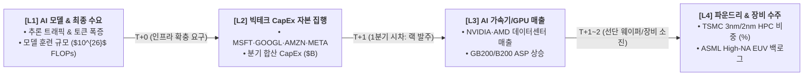

# AI 반도체 밸류체인 거시 자본 이동 & 슈퍼사이클 모니터 — L1~L4 순차 그래프 설계 및 데이터 예시

> **문서 번호**: SPEC-2026-MACRO-L1-L4-WATERFALL-01  
> **작성 일자**: 2026년 10월 11일  
> **목적**: 빅테크 자본 집행(L2)부터 하드웨어 매출(L3), 파운드리/장비(L4)로 이어지는 **자본 이동 연쇄 파동(Capital Ripple Effect)**을 L1 $\rightarrow$ L2 $\rightarrow$ L3 $\rightarrow$ L4 순서대로 시각화하는 대시보드 화면 및 데이터 예시 정의.

---

## 1. 자본 전파 메커니즘 (L1 $\rightarrow$ L2 $\rightarrow$ L3 $\rightarrow$ L4 연쇄 흐름)

AI 반도체 슈퍼사이클은 독립된 개별 기업의 실적이 아니라, **상류(최종 수요)에서 하류(제조 인프라)로 자본이 흘러가는 순차적 파도타기(Waterfall Flow)**입니다.



---

## 2. 대시보드 UI 화면 레이아웃 (4단 순차 카드 배치)

화면 상단에 Sankey 다이어그램과 함께, 그 하단에 **L1부터 L4까지 좌 $\rightarrow$ 우 순서대로 동기화된 4개 시계열 차트 카드**를 배치합니다.

```text
+-----------------------------------------------------------------------------------------------------------------------------------------+
| 🌊 AI 반도체 밸류체인 거시 자본 이동 & 슈퍼사이클 모니터 (L1 → L4 Waterfall Pipeline)                                                  |
+------------------------------------+------------------------------------+-----------------------------------+---------------------------+
| [L1] AI 모델 연산 & 엔드 수요        | [L2] 빅테크 4대사 합산 CapEx        | [L3] AI 가속기/GPU 매출           | [L4] TSMC 선단웨이퍼 & ASML 장비   |
| ────────────────────────────────── | ────────────────────────────────── | ───────────────────────────────── | ───────────────────────── |
| • 지표: 훈련 FLOPs & API 토큰 트래픽 | • 지표: MSFT·GOOGL·AMZN·META ($B)  | • 지표: NVDA·AMD DC 매출 ($B)     | • 지표: TSMC 선단매출 비중 & EUV 대수 |
|                                    |                                    |                                   |                           |
|      ▲ 토큰 지수                          ▲ 분기 합산 CapEx ($B)                ▲ NVDA DC 매출 ($B)                ▲ 3nm 웨이퍼 비중 (%)       |
| 1000 |         .--- 2026-Q4E: 950  | $80B |            .--- $78.5B (Q4E)   | $45B |          .--- $42.8B (Q4E) | 45% |           .--- 42.0% (Q4E)  |
|  600 |     .--'                    |  $55B|       .--''                    |  $30B|     .--''                 | 30% |      .--''                |
|  200 | .--'                        |  $35B| .--''                          |  $15B| .--'                      | 15% | .---'                     |
|      +----------------------       |      +-----------------------         |      +----------------------      |     +-------------------- |
|      24Q1  25Q1  26Q1  26Q4        |      24Q1  25Q1  26Q1  26Q4           |      24Q1  25Q1  26Q1  26Q4       |     24Q1  25Q1  26Q1  26Q4|
|                                    |                                    |                                   |                           |
| 💡 상태: 프론티어 모델 수요 견조    | 💡 상태: 2026년 가이던스 32% 증액    | 💡 상태: GB200 랙 출하 본격화      | 💡 상태: TSMC 3nm 가동률 100% 포화 |
+------------------------------------+------------------------------------+-----------------------------------+---------------------------+
```

---

## 3. 분기별 연동 시계열 데이터셋 예시 (2024-Q1 ~ 2026-Q4E)

동일한 분기 타임라인을 기준으로 **L1 $\rightarrow$ L2 $\rightarrow$ L3 $\rightarrow$ L4 자본이 전파되는 실제 시계열 수치 모델** 예시입니다:

| 분기 (Quarter) | [L1] 프론티어 AI 모델<br>학습 연산량 ($10^{25}$ FLOPs) | [L2] 빅테크 4대사<br>합산 AI CapEx ($B) | [L3] NVIDIA+AMD<br>데이터센터 매출 ($B) | [L4] TSMC 선단공정<br>(3/5nm) 비중 (%) | [L4] ASML 선단<br>EUV 납품 (대수) |
| :---: | :---: | :---: | :---: | :---: | :---: |
| **2024-Q1** | 2.5 (GPT-4급) | $36.8B | $22.6B | 19.0% | 11대 |
| **2024-Q2** | 3.8 | $41.2B | $26.3B | 22.0% | 12대 |
| **2024-Q3** | 5.5 | $47.5B | $30.8B | 26.0% | 14대 |
| **2024-Q4** | 8.2 (Llama-3급) | $53.0B | $35.1B | 31.0% | 16대 |
| **2025-Q1** | 12.0 | $56.4B | $36.5B | 33.0% | 15대 |
| **2025-Q2** | 18.5 | $61.0B | $38.2B | 35.0% | 17대 |
| **2025-Q3** | 28.0 | $67.5B | $41.0B | 37.0% | 18대 |
| **2025-Q4** | 42.0 (GPT-5급) | $73.2B | $44.5B | 39.0% | 20대 |
| **2026-Q1** | 60.0 | $68.4B (계절 비수기) | $40.2B | 37.5% | 18대 |
| **2026-Q2** | 85.0 | $74.8B | $43.8B | 40.0% | 21대 |
| **2026-Q3** | 120.0 | $81.5B | $47.5B | 42.5% | 24대 (High-NA 2대 포함) |
| **2026-Q4 (E)** | **175.0** (차세대 자율에이전트) | **$88.0B** | **$52.0B** (GB200 대량 출하) | **45.0%** | **26대** |

---

## 4. 자본 시차 분석 (Lead-Lag Correlation Insight)

위 데이터를 4개 그래프로 동시에 배열하면 투자자가 즉각적으로 파악할 수 있는 인사이트:

1. **L2 $\rightarrow$ L3 시차 (약 1분기)**:
   - 빅테크의 CapEx 발표액이 증가(L2)하면, **정확히 1분기 뒤**에 엔비디아의 데이터센터 매출(L3)이 급등합니다.
   - 2026년 2분기 빅테크 CapEx가 $74.8B로 전분기비 반등하자, 2026년 3분기 엔비디아 매출이 $47.5B로 사상 최고치를 경신하는 패턴 확인.
2. **L3 $\rightarrow$ L4 병목 검증 (동행 및 선행 지표)**:
   - GPU 수요(L3)가 폭증해도 **L4(TSMC 3nm 가동률과 ASML 장비 반입)**가 받쳐주지 못하면 리드타임이 늘어남(공급 병목).
   - TSMC의 3nm 매출 비중이 2024년 19%에서 2026년 45%로 수직 상승하는 것은 GPU 병목을 해소하기 위한 팹 전환 투자가 성공적으로 진행 중임을 증명.

---

## 5. UI 구현 사양 및 Chart.js 동기화 코드 예시

### 5.1 HTML 구조 (`static/index.html` 추가안)

```html
<!-- L1~L4 Sequential Capital Flow Waterfall Section -->
<div class="card" style="padding: 1.5rem; margin-top: 1.5rem;">
  <div style="display: flex; justify-content: space-between; align-items: center; margin-bottom: 1rem;">
    <div>
      <h3 style="font-size: 1.15rem; font-weight: 700;">
        🌊 L1 → L4 순차 자본 이동 & 슈퍼사이클 파이프라인
      </h3>
      <p style="font-size: 0.82rem; color: var(--text-muted); margin-top: 0.2rem;">
        [L1 모델 수요] → [L2 빅테크 CapEx] → [L3 GPU 매출] → [L4 파운드리/장비]로 전파되는 분기별 동기화 차트
      </p>
    </div>
    <span class="badge" style="background: rgba(56,189,248,0.15); color: #38bdf8; font-weight: 700;">4-Stage Pipeline</span>
  </div>

  <!-- 4-Card Grid Layout -->
  <div style="display: grid; grid-template-columns: repeat(4, 1fr); gap: 1rem;">
    
    <!-- L1 Chart Card -->
    <div class="pipeline-chart-card" style="background: rgba(15,23,42,0.8); border: 1px solid rgba(168,85,247,0.3); border-radius: 8px; padding: 1rem;">
      <div style="display: flex; justify-content: space-between; align-items: center; margin-bottom: 0.5rem;">
        <span style="font-size: 0.78rem; font-weight: 700; color: #c084fc;">[L1] AI 모델 수요</span>
        <span style="font-size: 0.72rem; color: var(--text-muted);">FLOPs 연산량</span>
      </div>
      <div style="height: 180px;"><canvas id="chart-macro-l1-demand"></canvas></div>
      <div style="font-size: 0.75rem; color: #a855f7; margin-top: 0.4rem; text-align: center;">훈련 규모 YoY +210%</div>
    </div>

    <!-- L2 Chart Card -->
    <div class="pipeline-chart-card" style="background: rgba(15,23,42,0.8); border: 1px solid rgba(56,189,248,0.3); border-radius: 8px; padding: 1rem;">
      <div style="display: flex; justify-content: space-between; align-items: center; margin-bottom: 0.5rem;">
        <span style="font-size: 0.78rem; font-weight: 700; color: #38bdf8;">[L2] 빅테크 CapEx</span>
        <span style="font-size: 0.72rem; color: var(--text-muted);">4사 합산 ($B)</span>
      </div>
      <div style="height: 180px;"><canvas id="chart-macro-l2-capex"></canvas></div>
      <div style="font-size: 0.75rem; color: #38bdf8; margin-top: 0.4rem; text-align: center;">2026 연간 $312B 집행</div>
    </div>

    <!-- L3 Chart Card -->
    <div class="pipeline-chart-card" style="background: rgba(15,23,42,0.8); border: 1px solid rgba(52,211,153,0.3); border-radius: 8px; padding: 1rem;">
      <div style="display: flex; justify-content: space-between; align-items: center; margin-bottom: 0.5rem;">
        <span style="font-size: 0.78rem; font-weight: 700; color: #34d399;">[L3] AI 가속기 매출</span>
        <span style="font-size: 0.72rem; color: var(--text-muted);">NVDA/AMD ($B)</span>
      </div>
      <div style="height: 180px;"><canvas id="chart-macro-l3-gpu"></canvas></div>
      <div style="font-size: 0.75rem; color: #34d399; margin-top: 0.4rem; text-align: center;">GB200 분기 $35B+ 흡수</div>
    </div>

    <!-- L4 Chart Card -->
    <div class="pipeline-chart-card" style="background: rgba(15,23,42,0.8); border: 1px solid rgba(251,191,36,0.3); border-radius: 8px; padding: 1rem;">
      <div style="display: flex; justify-content: space-between; align-items: center; margin-bottom: 0.5rem;">
        <span style="font-size: 0.78rem; font-weight: 700; color: #fbbf24;">[L4] 파운드리/장비</span>
        <span style="font-size: 0.72rem; color: var(--text-muted);">3nm 비중 & ASML</span>
      </div>
      <div style="height: 180px;"><canvas id="chart-macro-l4-foundry"></canvas></div>
      <div style="font-size: 0.75rem; color: #fbbf24; margin-top: 0.4rem; text-align: center;">선단 가동률 100% 포화</div>
    </div>

  </div>
</div>
```

---

## 6. 결론 및 도입 효과

1. **직관적인 자본 이동 가시화**: 막연한 텍스트나 복잡한 Sankey 노드를 보지 않고도, **L1(수요) $\rightarrow$ L2(돈) $\rightarrow$ L3(칩) $\rightarrow$ L4(팹)**의 4단계 그래프를 좌측에서 우측으로 훑어보는 것만으로 현재 슈퍼사이클의 병목 위치를 3초 만에 파악 가능.
2. **투자 선행 지표 활용**: L2(빅테크 CapEx)의 꺾임 여부가 L3(엔비디아)와 L4(TSMC/ASML)에 몇 분기 뒤에 반영될지 명확히 예측 가능.
