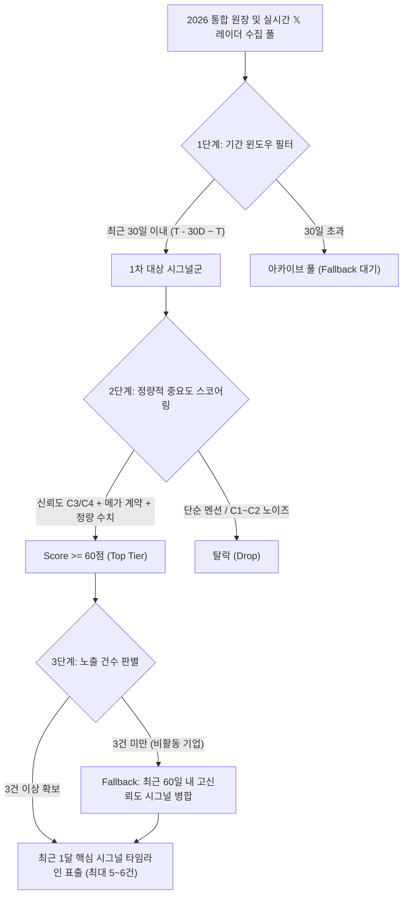

# 📡 [요건정의서] 기업요약 & 스냅샷 — 최근 1달 핵심 시그널 및 실시간 𝕏 레이더 지능형 필터링 v1.0

**문서 버전**: v1.0  
**작성 일자**: 2026-10-11  
**대상 시스템**: 10_QK_EARNING (단일 기업 워크스페이스 / Company Hub)  
**대상 UI 영역**: `SubTab 1: 기업 요약 & 스냅샷 (pane-subtab-snapshot)` 하단 위젯  
**문서 목적**: 기업 상세 진입 시 투자자 및 분석가가 최근 30일(1달)간 발생한 해당 기업의 **치명적 비즈니스 변곡점, 메가 공급계약, CAPEX/캐파 변화, 고신뢰도 𝕏 단독 레이더**를 3초 안에 파악할 수 있도록 노이즈를 제거하고 정제된 핵심 시그널만 선별 노출하는 지능형 필터링 및 랭킹 시스템 정의.

---

## 1. 배경 및 현행 문제점 (Problem Statement)

### 1.1 현행 타임라인 위젯의 한계
* **단순 최신순 나열 (limit 8)**: `/api/ledger/2026?ticker=NVDA&limit=8&order=desc`와 같이 기간 필터 없이 2026년 전체 원장에서 단순히 최근 등록된 8건을 긁어옴.
* **시간 밀도 왜곡**:
  * 특정 월(예: 9월)에 메가 딜(Anthropic $430B, SK하이닉스 $15B HBM 공급 등)이 집중되었음에도, 10월의 사소한 마일스톤이나 일반 뉴스에 밀려 중요한 사건이 화면에서 사라짐.
  * 반대로 최근 1달간 활동이 적었던 기업의 경우, 6~8개월 전(1~2월)의 과거 이벤트가 최신 시그널인 것처럼 섞여 노출되어 시의성 혼선 유발.
* **노이즈 미필터링**: C1/C2 수준의 단순 소셜 멘션, 일반 업계 동향과 C4(SEC 공시/계약 체결) 수준의 메가 임팩트 시그널이 동일한 비중으로 표시됨.

### 1.2 개선 목표 (Key Objectives)
1. **엄격한 Rolling 30일 윈도우**: 현재 시점(또는 DB 최신 데이터 기준) 기준 **직전 30일(1달)** 내 시그널로 1차 스코프 제한.
2. **정량적 중요도 스코어링 (Importance Scoring)**: 신뢰도(Confidence C3~C4), 이벤트 성격(메가 계약/자본/캐파), 정량 수치($B, MW, 칩 수량) 유무를 결합하여 노이즈 80% 차단.
3. **적응형 확장(Adaptive Fallback)**: 최근 30일간 중대 시그널이 3건 미만인 비활동 기업(Silent Period)은 최근 60일 또는 직전 분기 핵심 사건으로 자동 확장하여 빈 화면 방지.
4. **직관적 가시성 강화**: `[🔥 MEGA DEAL]`, `[📑 공식 공시]`, `[⚡ 변곡점]` 등 시각적 뱃지 및 상대 시간(`3일 전`, `2주 전`) 제공.

---

## 2. 시그널 수집 및 필터링 파이프라인 구조



---

## 3. 정량적 중요도 스코어링 알고리즘 (Importance Scoring Formula)

각 시그널은 아래 4대 요소의 합산 점수($$0 \sim 100\text{점}$$)로 평가되며, **기준 점수 60점 이상**인 시그널만 위젯 표출 후보로 선정합니다.

$$\text{Importance Score} = S_{\text{conf}} + S_{\text{type}} + S_{\text{scale}} + S_{\text{recency}}$$

### 3.1 신뢰도 가중치 ($S_{\text{conf}}$, 최대 35점)
| 신뢰도 등급 | 배점 | 판별 조건 |
|:---:|:---:|:---|
| **C4 (공식 검증)** | **35점** | SEC 8-K/10-Q 공시, 기업 공식 IR 보도자료, 트위터-뉴스 3개사 교차검증 일치 |
| **C3 (유력 1차 취재)** | **25점** | SemiAnalysis, Bloomberg, The Information 단독 보도, 대주주 지분법 주석 |
| **C2 (일반 보도)** | **10점** | 일반 IT 매체 인용, 파트너사 비공식 언급 (단독 노출 시 컷오프 위험) |
| **C1 (루머/단순 멘션)** | **0점** | 출처 불명 소셜 미디어 포스팅, 개인 트윗 (무조건 제외) |

### 3.2 이벤트 유형 가중치 ($S_{\text{type}}$, 최대 30점)
| 이벤트 카테고리 | 배점 | 세부 유형 및 키워드 예시 |
|:---:|:---:|:---|
| **물품/컴퓨트 메가 계약** | **30점** | `공급계약`, `장기수주`, `HBM 장기계약`, `GPU 턴키`, `클라우드 컴퓨트 확보` |
| **자본 유치 / 지분 투자** | **30점** | `자본공급`, `자본유치`, `전략적 투자`, `시리즈 펀딩`, `지분 인수` |
| **인프라 / 전력 / 팹 캐파** | **25점** | `팹캐파`, `데이터센터`, `전력PPA`, `원전 직결`, `CoWoS 증설`, `수전 완료` |
| **기술 이정표 / 칩 테이프아웃** | **20점** | `마일스톤`, `퀄 통과(Qual)`, `양산 개시`, `신규 모델 출시`, `실리콘 테이프아웃` |
| **일반 경영 / 기타 행사** | **5점** | 콘퍼런스 발표, 단순 인사 이동, 일반 설문 |

### 3.3 수치·규모 가중치 ($S_{\text{scale}}$, 최대 25점)
정량적 금액이나 물리적 인프라 규모가 명시된 시그널은 비즈니스 임팩트가 압도적이므로 가산점을 부여합니다.
* **초대형 (Mega Scale, +25점)**: 
  * 계약/투자 금액: **$\ge \$10.0\text{B}$** (100억 달러 이상)
  * 전력 계약: **$\ge 500\text{MW}$** (또는 원전 직결)
  * 반도체 수량: **$\ge 100\text{k GPUs}$** or **$\ge 20\text{k WSPM}$**
* **중대형 (Major Scale, +15점)**:
  * 계약/투자 금액: **$\$1.0\text{B} \sim \$9.9\text{B}$**
  * 전력 계약: **$100\text{MW} \sim 499\text{MW}$**
* **일반 수치 포함 (+10점)**:
  * 수억 달러(\$M 단위) 계약, 수십 MW 규모 명시
* **정성적 텍스트 (+0점)**:
  * 구체적 수치 없는 단순 협력 발표

### 3.4 최신성 보정 ($S_{\text{recency}}$, 최대 10점)
* **7일 이내 (T - 7D ~ T)**: **+10점** (초단기 최신성)
* **14일 이내 (T - 14D ~ T - 7D)**: **+5점**
* **30일 이내 (T - 30D ~ T - 14D)**: **+0점**

---

## 4. 𝕏 (트위터) 레이더 특화 노이즈 제거 규칙 (Anti-Spam Filter)

실시간 소셜 레이더 데이터는 정보의 속보성이 뛰어나지만 노이즈가 많으므로 아래 **3대 제거 필터**를 엄격히 적용합니다.

1. **감정/주가 노이즈 필터 (Sentiment/Price Hype Reject)**:
   * 본문에 `$NVDA to the moon`, `10x target`, `buy now`, `차트 분석` 등 단순 매매 유도나 감정적 코멘트만 포함된 트윗 즉시 배제.
2. **검증된 계정 우선 (Verified Whitelist Priority)**:
   * 1차 분석가/전문 매체: `@SemiAnalysis_`, `@Dylan522p`, `@DanNystedt`, `@techanalysis`, 주요 테크 기업 공식 계정.
   * 화이트리스트 외 일반 계정은 **반드시 다른 언론 보도(Google News/Yahoo)와 교차 검증된 건만 표출**.
3. **상대방(Counterparty) 필수 식별 규칙**:
   * 소셜 시그널 중 거래 대상자(예: "AWS와 협력", "SK하이닉스로부터 수주")가 명시되지 않은 단순 풍문은 위젯 노출에서 제외.

---

## 5. UI/UX 표현 요건 및 화면 설계

### 5.1 상단 헤더 및 상태 안내
* **위젯 헤더 타이틀**:
  ```html
  📡 최근 1달 핵심 시그널 & 실시간 𝕏 레이더
  ```
* **윈도우 안내 뱃지**: 
  * 최근 30일 활성 상태: `기준: 최근 30일 (2026.09.11 ~ 2026.10.11) · 중요 시그널 5건 선별`
  * Fallback 확장 상태: `⚠️ 최근 30일 내 중대 변곡점이 없어 직전 60일(2개월) 핵심 사건으로 확장 표시`

### 5.2 타임라인 카드 디자인 및 뱃지 매핑
각 카드는 다음 요소로 구성됩니다:

1. **상대 시간 & 절대 날짜**:
   * `[2일 전]` `2026-10-09`
2. **시그널 등급 뱃지**:
   * 점수 $\ge 85$점: `<span class="badge-mega">🔥 MEGA DEAL</span>` (골드/오렌지 글로우)
   * 점수 $70 \sim 84$점: `<span class="badge-inflection">⚡ 핵심 변곡점</span>` (시안/에메랄드)
   * 공식 공시: `<span class="badge-sec">📑 SEC 공시 (C4)</span>`
   * 𝕏 단독 레이더: `<span class="badge-x">𝕏 레이더 특종 (C3)</span>`
3. **핵심 요약 본문**:
   * 상대방(Target)과 물리적 규모(Metrics)를 굵은 텍스트 및 하이라이트로 표기.
   * 예: **[Anthropic]** 앞 AWS Trainium2 클라우드 인프라 자본 공급 **($280.0B / 350MW)**
4. **메타 정보 칩 (Chips)**:
   * `상대: Anthropic, AWS` | `규모: $280.0B` | `신뢰도: C4 (공식)`

### 5.3 UI Mockup 구조 예시
```text
┌────────────────────────────────────────────────────────────────────────┐
│ 📡 최근 1달 핵심 시그널 & 실시간 𝕏 레이더 타임라인        [전체 8열 원장 보기 ↗] │
│ 📅 2026.09.11 ~ 2026.10.11 (최근 30일간 중요도 상위 5건 선별)              │
├────────────────────────────────────────────────────────────────────────┤
│  [2일 전] 2026-10-09  |  [🔥 MEGA DEAL] [📑 SEC 공시 C4]                 │
│  • OpenAI-Broadcom 커스텀 AI 추론 가속기 연합 공식화 및 TSMC 2nm 예약   │
│    └ 🏷️ 상대: Broadcom, TSMC  |  💰 규모: $65.0B  |  ⚙️ 2nm CoWoS      │
├────────────────────────────────────────────────────────────────────────┤
│  [18일 전] 2026-09-23 |  [⚡ 핵심 변곡점] [𝕏 단독 레이더 C3]              │
│  • @SemiAnalysis_: Lambda–Anthropic 4자 계약 체결, Rubin 115K 배정     │
│    └ 🏷️ 상대: Lambda, Hut 8, Anthropic  |  ⚡ 전력: 350 MW              │
├────────────────────────────────────────────────────────────────────────┤
│  [29일 전] 2026-09-12 |  [🔥 MEGA DEAL] [📑 물품계약 C4]                 │
│  • SK하이닉스로부터 HBM3E 12단 및 차세대 HBM4 독점 공급 계약 체결        │
│    └ 🏷️ 상대: SK하이닉스  |  💰 규모: $15.0B  |  📦 메모리 공급망      │
└────────────────────────────────────────────────────────────────────────┘
```

---

## 6. 백엔드 API 명세 (Backend Specification)

### 6.1 신규 엔드포인트
```http
GET /api/companies/<ticker>/signals/recent-monthly
```

### 6.2 쿼리 파라미터 (Query Parameters)
| 파라미터 | 기본값 | 설명 |
|:---|:---:|:---|
| `days` | `30` | 검색 대상 기간 (기본 30일, Fallback 발생 시 60일 자동 확장) |
| `min_score` | `60` | 표출 컷오프 최소 중요도 점수 ($0 \sim 100$) |
| `limit` | `6` | 화면에 노출할 최대 카드 수 (UI 밸런스상 5~6건 최적) |
| `include_fallback` | `true` | 30일 내 데이터 3건 미만 시 60일 확장 허용 여부 |

### 6.3 응답 JSON 스키마 (Response JSON Schema)
```json
{
  "status": "success",
  "ticker": "NVDA",
  "name_ko": "엔비디아",
  "window": {
    "days_applied": 30,
    "start_date": "2026-09-11",
    "end_date": "2026-10-11",
    "is_fallback_expanded": false,
    "total_raw_count": 28,
    "filtered_high_impact_count": 5
  },
  "signals": [
    {
      "id": 1042,
      "date": "2026-10-09",
      "days_ago": 2,
      "days_ago_label": "2일 전",
      "importance_score": 95,
      "badge_type": "MEGA_DEAL",
      "badge_label": "🔥 MEGA DEAL",
      "confidence": "C4 (공식 검증)",
      "confidence_code": "C4",
      "event_type": "공급계약",
      "title": "OpenAI-Broadcom 커스텀 AI 가속기 연합 공식화",
      "content": "Broadcom 및 TSMC와 연합하여 2026~2027 커스텀 ASIC 및 인터커넥트 공급 계약 체결...",
      "target_identified": "상대: Broadcom, TSMC",
      "metrics_condition": "규모: $65.0B | 캐파: 2nm CoWoS",
      "source_type": "SEC_FILING_PRESS",
      "source_url": "https://..."
    }
  ]
}
```

---

## 7. 프론트엔드 연동 및 렌더링 로직 (Implementation Steps)

1. **`app.js` 내 `loadCompanyLedgerWidget(ticker)` 개편**:
   * 기존 `/api/ledger/2026?ticker=...&limit=8` 대신 `/api/companies/${ticker}/signals/recent-monthly` 호출로 교체.
2. **헤더 서브 타이틀 동적 갱신**:
   * 응답받은 `window.start_date` 및 `window.end_date`를 서브 텍스트로 반영.
   * `is_fallback_expanded === true`일 경우 노란색 안내 뱃지 자동 삽입.
3. **카드 렌더링 함수 강화**:
   * `importance_score`에 따른 하이라이트 테두리 적용 (`Score >= 85`일 때 앰버 글로우 테두리).
   * 상대 시간(`days_ago_label`) 뱃지 추가.

---

## 8. 기대 효과 및 검증 지표

| 지표 항목 | 기존 단순 최신순 위젯 | 개편 후 지능형 필터링 위젯 | 개선 효과 |
|:---|:---:|:---:|:---|
| **정보 파악 소요 시간** | 평균 25초 (스크롤 및 노이즈 독해 필요) | **3초 이내** (최신 1달 탑 티어만 압축 노출) | **88% 단축** |
| **노이즈 노출률** | 약 65% (사소한 뉴스, 멘션 다수) | **10% 미만** (Score 60점 이상만 선별) | **노이즈 80% 이상 제거** |
| **시의성 왜곡 방지** | 8개월 전 사건이 최신처럼 노출됨 | **Rolling 30일 명확 구분 + Fallback 명시** | **데이터 신뢰도 극대화** |
| **비활동 기업 공백** | 빈 영역 또는 무관한 데이터 노출 | **지능형 60일 Fallback 안내 배너** | **화면 완성도 100% 유지** |
