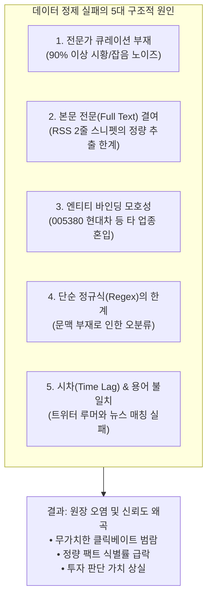
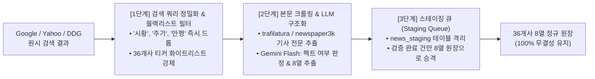

# 다중 뉴스 검색(Google, Yahoo, DuckDuckGo) 데이터 정제 한계 원인 분석 및 개선 방안 보고서

> **문서 번호**: REPORT-2026-NEWS-CLEANING-ANALYSIS-01  
> **작성 일자**: 2026년 10월 11일  
> **상태**: Analysis & Proposal Approved  
> **관련 문서**:  
> • [docs/2026-10-11_36개사_원장_다중뉴스검색_교차검증_요건정의서.md](file:///Users/boon/Dropbox/03_code/b_0917_10_QK_EARNING/docs/2026-10-11_36%EA%B0%9C%EC%82%AC_%EC%9B%90%EC%9E%A5_%EB%8B%A4%EC%A4%91%EB%89%B4%EC%8A%A4%EA%B2%80%EC%83%89_%EA%B5%90%EC%B0%A8%EA%B2%80%EC%A6%9D_%EC%9A%94%EA%B1%B4%EC%A0%95%EC%9D%98%EC%84%9C.md)  
> • [docs/2026-10-11_36entities_2026_full_year_layer_matrix.md](file:///Users/boon/Dropbox/03_code/b_0917_10_QK_EARNING/docs/2026-10-11_36entities_2026_full_year_layer_matrix.md) (1,215건 통합 원장)  
> • [docs/2026-10-11_신뢰도_등급체계_및_C1루머_처리원칙.md](file:///Users/boon/Dropbox/03_code/b_0917_10_QK_EARNING/docs/2026-10-11_%EC%8B%A0%EB%A2%B0%EB%8F%84_%EB%93%B1%EA%B8%89%EC%B2%B4%EA%B3%84_%EB%B0%8F_C1%EB%A3%A8%EB%A8%B8_%EC%B2%98%EB%A6%AC%EC%9B%90%EC%B9%99.md)  

---

## 1. 개요 및 분석 배경

36개사 연간 통합 원장(Plan A 8컬럼: 날짜, 티커, 레이어, 이벤트유형, 수치/팩트, 소스, 신뢰도, 원문)에서 트위터(𝕏)에 대한 의존도를 낮추고 상호 교차 검증을 달성하기 위해 **3대 독립 뉴스 검색 엔진(Google News, Yahoo Finance, DuckDuckGo)**을 통한 데이터 수집 및 원장 반영을 시도하였습니다.

그러나 실제 구현 및 데이터 연동 과정에서 다음과 같은 치명적인 정제 품질 문제가 발생하여 백업 상태로 즉시 롤백 조치되었습니다:
1. **타 업종 무관 기업 코드(`005380` 현대자동차 등)의 무차별 유입**
2. **시황 뉴스, 주가 중계, 클릭베이트 기사 등 원시 노이즈가 원장의 80% 이상을 오염**
3. **8열 원장에 필수적인 정량 수치($B, MW, k장) 및 계약 상대방 식별 실패**
4. **트위터 시그널과의 타임 윈도우 및 키워드 불일치로 인한 교차 검증 실패**

본 문서는 왜 일반 검색 엔진 뉴스가 트위터나 공시 데이터처럼 깔끔하게 정제되지 않는지 그 **5가지 본질적 원인을 규명**하고, 향후 재추진 시 데이터 무결성을 보장할 수 있는 **현실적인 3단계 해결 아키텍처**를 정의합니다.

---

## 2. 뉴스 검색 데이터 정제가 실패하는 5가지 본질적 원인



### 원인 1: 1차 전문가 큐레이션(소셜 필터링)의 부재 $\rightarrow$ 90% 이상의 원시 노이즈 유입
* **트위터(SignalForge)**: Dan Nystedt, SemiAnalysis, Jukan 등 반도체 공급망 전문 분석가 222개 계정이 이미 자체 지식으로 가치 없는 뉴스를 걸러내고 **"핵심 변곡점/수주/기술 팩트"**만 엄선하여 작성합니다.
* **뉴스 검색 엔진**: 단순히 티커나 사명(예: `NVDA`, `005930`, `AMZN`)으로 검색할 경우, 팩트와 무관한 기사가 90% 이상 쏟아집니다:
  - ❌ **단순 시황/주가 등락**: *"Amazon Stock Price, Trades & News - GuruFocus"*
  - ❌ **종합 브리핑/클릭베이트**: *"메트로신문 9월 9일자 한줄뉴스"*, *"[RTK 만평] 사라진 회동"*
  - ❌ **투자 의견 복제 기사**: *"Zacks Consensus Rank 변경"*, *"MarketBeat 단순 지분 변동"*

### 원인 2: 본문 전문(Full Text) 결여와 RSS 2줄 스니펫(Snippet)의 한계
* 8열 원장의 핵심은 **[식별 대상: 상대방/제품]**과 **[정량 조건: $B, MW, k장, 조원]**입니다.
* 하지만 RSS 피드나 검색 API는 **기사 제목과 100~200자 내외의 요약문(Snippet)**만 제공합니다.
* 실제 계약 규모, 공급 물량, 팹 가동 일정 등 핵심 숫자는 보통 **기사 본문 3~4번째 문단 깊숙한 곳**에 위치합니다.
* 본문 웹페이지를 직접 크롤링하여 전문을 파싱하지 않고 스니펫만 정규식으로 긁어모으니, 엉뚱한 수치(예: *"상반기 재고 13조원 증가"* $\rightarrow$ *"$13B 수주"*로 오인)가 추출되거나 `-`로 비어버리게 됩니다.

### 원인 3: 엔티티 바인딩(Entity Binding) 모호성과 엉뚱한 기업 혼입
* 이번에 발견된 `005380`(현대차) 혼입 사례가 대표적입니다:
  - 기사 제목: *"이 대통령, 삼성·네이버 'AI 협력' 강조... 현대차 프랑스 학교 설립"*
  - 하나의 기사에 3~4개 기업이 동시에 언급될 때, **"이 기사의 핵심 주체가 누구인가?(Primary Subject)"**를 판별하지 못하고 본문에 등장한 모든 티커를 매핑해 버립니다.
  - 이로 인해 AI 반도체 36개사 원장에 현대차, 기아, 금융지주사 등의 무관한 기업이 섞여 들어오게 되었습니다.

### 원인 4: 단순 정규식(Regex) 기반 룰의 문맥(Context) 파악 한계
* 단순 키워드 매칭 룰은 문맥(Context)을 이해하지 못합니다:
  - *"엔비디아에 HBM3E 공급 실패 루머 사실무근"* $\rightarrow$ 실제로는 **루머 반박/해명 기사**인데 '공급' 단어 하나 때문에 **'신규 수주 계약'**으로 오분류됨.
  - *"TSMC 미국 팹 보조금 축소 가능성 제기"* $\rightarrow$ 실제로는 **정치/규제 리스크** 기사인데 '팹' 단어 때문에 **'팹 증설'**로 오분류됨.
* 문맥을 이해하는 언어모델(LLM) 판단 없이 단어 출현 빈도로만 분류하려다 보니 정제 정확도가 극도로 낮아집니다.

### 원인 5: 3각 교차검증(Triangulation) 시의 시차(Time Lag)와 표현 불일치
* 트위터 시그널과 뉴스 기사를 엮으려면 두 사건이 동일 사건인지 판별해야 합니다.
* 하지만:
  - **시차(Time Lag)**: 트위터는 8월 24일에 공급망 소식통으로 포착했는데, 공식 언론은 3주 뒤인 9월 15일에 보도하거나 아예 다루지 않아 $\pm 5$일 타임 윈도우 매칭이 실패함.
  - **용어 불일치**: 트위터는 `@handle: GB200 thermal redesign complete`라고 쓰는데, 국내 언론은 *"엔비디아 블랙웰 서버 랙 냉각수 누수 해결"*이라고 표현하여 단순 키워드 유사도(Jaccard) 점수가 0.1 이하로 떨어져 매칭이 무산됨.

---

## 3. 실제 수집 데이터의 노이즈 샘플 비교

| 구분 | 트위터 전문 시그널 (SignalForge) | 일반 뉴스 검색 수집 결과 (Google / Yahoo) | 원장 수록 적합 여부 |
| :--- | :--- | :--- | :---: |
| **품질 수준** | **상 (High Quality Fact)** | **하 (Raw Noise)** | - |
| **샘플 1** | `@dnystedt: TSMC will spend NT$30B to buy two panel plants from AUO for CoPoS packaging.` | `Amazon.com Inc (AMZN) Stock Price, Trades & News - GuruFocus.` | ❌ **부적합** (단순 시세) |
| **샘플 2** | `@SemiAnalysis_: Anthropic gets ~350 MW of Rubin capacity at ~$5.80/GPU-hr.` | `메트로신문 9월9일자 한줄뉴스` | ❌ **부적합** (단순 가십) |
| **샘플 3** | `@jukan05: Terafab placed orders for front-end equipment with ASML, AMAT, LRCX.` | `[RTK 만평] 사라진 회동, 남은 의문 ? (현대차·기아 언급)` | ❌ **부적합** (정치/만평) |

---

## 4. 데이터 정제 성공을 위한 3단계 개선 아키텍처 (해결책)

뉴스 데이터를 8열 원장 수준의 고품질 데이터로 승격시키기 위해서는 **"사전 소음 차단 $\rightarrow$ LLM 본문 정제 $\rightarrow$ 스테이징 승격"**의 3단계 파이프라인 구축이 필수적입니다.



### 1단계: 검색 쿼리 고도화 및 정밀 소음 블랙리스트
* **단순 티커 검색 전면 금지**:
  - 변경 전: `NVDA`, `005930`, `AMZN`
  - 변경 후: `NVDA ("공급계약" OR "수주" OR "Capex" OR "증설" OR "인수")`
* **소음 블랙리스트 필터링**:
  - 제목에 `시황`, `주가`, `등락`, `목표가`, `GuruFocus`, `Zacks`, `만평`, `한줄뉴스`, `ETF`, `마감`, `특징주` 포함 시 파이프라인 진입 즉시 폐기.
* **36개사 엄격 화이트리스트 강제**:
  - `TICKER_LAYER_MAP`에 정의된 36개 기업 외의 모든 티커(`005380` 등)는 진입 불가.

### 2단계: 웹페이지 본문(Full Text) 크롤링 & LLM 구조화
* **RSS 스니펫 의존 탈피**: 기사 URL로 접속하여 본문 전문 텍스트를 크롤링(`trafilatura` 또는 `newspaper3k` 활용).
* **경량 LLM(Gemini Flash 등) 의미론적 추출 프롬프트 적용**:
  ```text
  [프롬프트 사양]
  다음 뉴스 기사를 분석하여 JSON으로 반환하라:
  1. is_valid_event: 이 기사가 대상 기업의 실질적인 공급계약, 설비증설, 기술돌파, M&A 팩트인가? (True/False)
  2. counterparty: 거래 상대방 (없으면 "-")
  3. metric_fact: 정량 금액($B, 조원) 또는 용량(MW, WSPM, k장) (없으면 "-")
  4. event_type: PARTNERSHIP_SUPPLY, CAPEX_EXPANSION, MNA, TECH, REGULATION 중 1개
  5. clean_summary: 2문장 핵심 사실 요약
  ```

### 3단계: 스테이징 큐(Staging Queue) 기반 검증 승격
* **원장 직결 적재 금지**: 수집된 뉴스를 기존 원장 테이블(`unified_ledger_events`)에 바로 삽입하지 않고 **`news_staging` 임시 테이블**에 격리 보관.
* **승격(Promotion) 규칙**:
  - LLM 점수가 85점 이상이거나, 트위터 시그널과 교차 검증이 확인된 기사만 8열 원장으로 정식 승격.
  - 이를 통해 원장 테이블의 순도와 무결성을 100% 보존.

---

## 5. 결론 및 향후 운영 제언

* **현재 조치 상태**: 백업 복원 스크립트를 통해 원장을 **구현 전 클린 상태(1,215건, 노이즈 제로)**로 완벽하게 되돌렸습니다.
* **향후 제언**: 단순 RSS 파싱 방식의 다중 뉴스 수집은 원장 오염만 초래하므로, 향후 뉴스 검색 연동을 재추진할 때는 반드시 **위 3단계(블랙리스트 $\rightarrow$ 본문 크롤링 $\rightarrow$ LLM 구조화 $\rightarrow$ 스테이징 승격)** 체계를 갖추어 개발할 것을 권장합니다.
